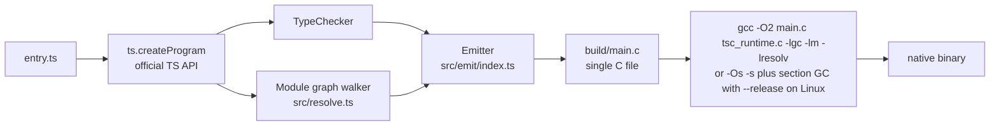
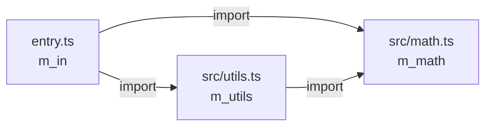
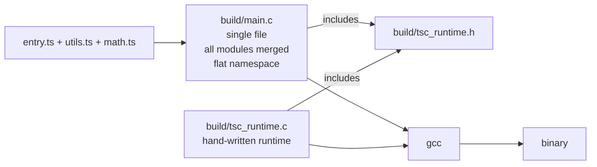
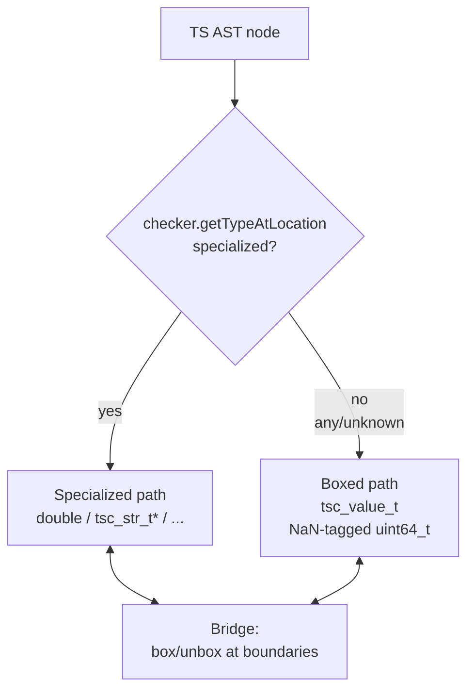
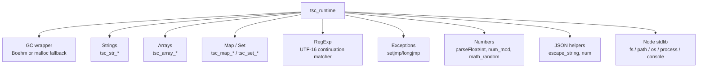
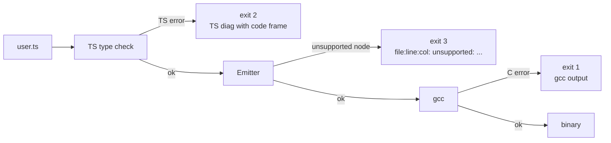

Iterator eager consumers now share one operation collection and rooted direct IteratorRecord algorithm for forEach, reduce, some, every, find and toArray. Callback validation closes before reading next; callback throws close with incoming throw precedence, while next/done/value failures mark the record complete and propagate without closing. Predicate early completion closes normally and preserves abrupt return behavior. Encoded item Lists and retained accumulators preserve arbitrary values; the counter remains an unbounded mathematical integer projected to Number for callbacks. The bool-selected predecessor has been removed.

See tests/property/iterator-eager-consumer.property.test.ts for Node differential metadata, direct receiver, callback, close and empty/short-circuit partitions with one deep retained iterator/owner graph, and tests/e2e/cases/iterator_eager_consumers for typed Set iterator consumers. Iterator constructor/from, lazy helpers with a depth-independent activation worklist, remaining iterator metadata/cross-realm behavior and exhaustive eligible Test262 coverage remain open; no full control-abstraction clause is promoted.

TextEncoder/TextDecoder now use per-realm ordinary owners for the represented UTF-8 surface. One member collection installs callable encode/decode functions and encoding/fatal/ignoreBOM getters with Node metadata; actual constructor argument Lists and newTarget prototypes use the existing ordinary path. Cached wrappers retain payloads and prototypes across allocation and suspension. Native source CTypes, constructor dispatch and method/boxing shortcuts have been removed. Receiver validation throws TypeError before conversion.

UTF-8 encode uses the shared well-formed String kernel to replace lone surrogates. Decode walks byte sequences with bounded scalar state, replacement/reconsumption for malformed prefixes and initial BOM removal. Buffer, ArrayBuffer and DataView inputs share native byte borrows and current DataView witnesses after options conversion. See tests/property/text-codec-owner.property.test.ts and tests/e2e/cases/text_codec_ordinary for Node differential owner/byte/argument/mutation partitions, one deep retained codec graph and a fully typed suspended consumer. Complete Encoding labels and options, streaming state, encodeInto, Uint8Array result fidelity and complete util import parity remain open. Unsupported represented options and labels fail closed; these host API checks do not establish ECMAScript conformance.

Environment property and element reads now return an encoded string-or-undefined result from one runtime producer. Prior TypeScript assignments cannot narrow a later absent native variable into an empty string after deletion or host mutation. Native key conversion allocates the complete key instead of truncating it to a fixed buffer. Node differential checks cover typed import aliases and direct global reads, empty/present/absent transitions and long keys in CLI/observation profiles and both memory modes. Named process imports in the JavaScript observation profile and loop-context JavaScript process.env access still fail closed because ordinary module/global owners are missing; the property test preserves those stable diagnostic contracts. See tests/property/process-env-boxed.property.test.ts and tests/e2e/cases/process_env_boxed_read for the typed suspended consumer. Ordinary process/env owners, complete assignment coercion and remaining Node process parity remain open.

Proxy defineProperty success validation now uses one actual target descriptor and extensibility algorithm, replacing duplicated array, function and ordinary-object branches. A successful trap cannot claim to make a non-configurable writable data property non-writable while the actual target remains writable. Nested target proxies preserve descriptor-before-extensibility observation, false traps skip target validation, and abrupt target descriptor operations propagate their original value. See tests/property/proxy-define-descriptor.property.test.ts for Node differential transition/compatibility/order partitions and one deep retained proxy graph.

The function-proxy regression now uses explicit strict functions and actual accessor syntax, checks TypeError identity, and verifies strict rejection of locked prototype assignment against Node. tests/e2e/cases/proxy_function_prototype_invariants passes in both memory modes. Remaining Proxy internal methods, exotic descriptor behavior, cross-realm cases and exhaustive eligible Test262 evidence remain open.

Set composition methods now live on the ordinary Set prototype and share one operation collection, rooted set-like record and insertion-cursor/IteratorRecord algorithm. Validation observes size, its numeric conversion, has and keys in order after receiver branding. Size selects the prescribed live-has or keys-iterator path; copy timing, duplicate keys, SameValueZero, mutations and predicate early closing follow that shared representation. Results use the intrinsic Set prototype without consulting species. The native two-Set kernels and fixed element-type emitter branches have been deleted. ReadonlySetLike declarations accept Map and custom operands.

Node differential properties cover metadata, receiver/operand validation, observable conversions, actual arguments, copy/mutation ordering, duplicate keys and abrupt iterator closing, with one deep retained owner/result graph. See tests/property/set-composition.property.test.ts and tests/e2e/cases/set_composition_set_like. Existing composition and ignored-argument regressions use the same path in both memory modes. Complete collection and iterator clauses, cross-realm behavior and exhaustive eligible Test262 coverage remain open.

ArrayBuffer now has per-realm ordinary constructor/prototype owners from one operation collection. Construction evaluates the complete argument List, converts length and the observable maxByteLength option, and uses the actual newTarget prototype. Resize, species-aware slice, transfer and transferToFixedLength share native storage transitions with ordered conversion, attachment and bounds checks. The native source CType, fixed constructor/property paths and fresh-allocation effect shortcuts have been removed. Ordinary boxed property reads preserve mutable accessor results instead of narrowing them from static declarations.

One DataView witness algorithm computes the current data, offset and extent for fixed and length-tracking views, including out-of-bounds recovery after resize. Collector-owned byte snapshots keep native borrows valid across resize and detachment; native weak-link checks prove that released snapshots become collectible. Node differential properties cover ordinary metadata and receivers, options, conversions, species, transfers and view transitions, with one deep retained buffer/view graph. Fully typed ArrayBuffer, DataView and stdio consumers pass in both memory modes. See tests/property/arraybuffer-owner.property.test.ts, tests/property/arraybuffer-storage-gc.property.test.ts and tests/e2e/cases/array_buffer_ordinary. SharedArrayBuffer/Atomics, complete TypedArray integration, cross-realm semantics and exhaustive eligible Test262 evidence remain open; this does not establish full target conformance.

DataView now has per-realm ordinary constructor/prototype owners. One element/getter collection creates its public functions and descriptors; a shared byte-access algorithm validates private receiver slots, performs ordered index and Number/BigInt conversions, checks attachment and bounds, and reads or writes the requested byte order. Binary16 conversion rounds directly from binary64, and shared GMP projections preserve complete 64-bit BigInt patterns. Constructors retain the initial bounds snapshot across length conversion, read the actual newTarget prototype, and recheck attachment before publication. The old DataView CType, constructor/property lowering and name-based effect shortcuts have been removed.

Node differential properties cover metadata, mutable owners/accessors, borrowed and Proxy receivers, complete argument Lists, scalar byte formats and conversion/detachment ordering, with one deep retained view/buffer graph under collection. Fully typed DataView consumers and ArrayBuffer and stdio integration regressions run in both memory modes. Buffer.byteLength reads a view's public byteLength property and preserves boxed getter results. The shared numeric buffer-index kernel now truncates finite inputs, maps NaN to zero, and throws RangeError for invalid indices. Shared backing stores, complete TypedArray integration, cross-realm behavior and exhaustive eligible Test262 evidence remain open; these checks do not establish full ECMAScript conformance.

Stdio write calls evaluate one complete boxed argument List before runtime validation and schedule callable completions on the shared next-tick worklist. Each stream retains its current batching record; equal callbacks share one job, successful callbacks receive one null argument, and recursive writes enqueue through the same growing collection. Non-callable callbacks are ignored. The compiler recognizes only unshadowed process bindings or process imports and uses this path from both TypeScript and JavaScript. Consumed next-tick slots release their retained environments; the artificial recursion-depth guard has been removed. Function-body scope initialization now unwinds its compiler stacks when initialization reports a diagnostic.

Node differential properties cover callback timing, batching, arguments, receiver semantics, validation, local process shadowing, and one deep retained callback graph across CLI/native observation and both memory modes. Typed stdio and recursive next-tick E2Es and native weak-lifetime checks provide regression evidence. Ordinary process/stdio owners, the complete Writable end/backpressure/error surface, all byte codecs and typed arrays remain open. These local checks do not establish full ECMAScript conformance.

Buffer static calls now lower through one complete boxed argument List and canonical operation collection. Native result projections come from the same collection, preserving existing byte and numeric API boundaries. Runtime validation follows evaluation of every argument, so computed numeric inputs and spread/extra arguments retain their source semantics. Concatenation keeps the source Array authoritative across validation and copy passes, including changing getters and Proxy reads, and uses the shared relational operation for loop bounds. The fixed compiler static cases and native pointer-array concatenation predecessors were deleted. Independent Node properties cover semantic partitions and one deep retained byte-owner graph; the original filesystem abort allocation trigger passes in both memory modes. Mutable Buffer static owners/constructor identity, complete byte codecs and general Uint8Array/TypedArray ownership remain open, as does full target conformance.

Buffer verification: independent Node comparisons passed for runtime argument validation, argument/conversion order, changing concatenation sources, private byte-view lengths and one deep retained graph across typed and JavaScript CLI/native observation runs in both memory modes. The typed static-argument regression, original Buffer fixture and filesystem allocation trigger passed; descriptor-derived result projection also restores native transcode integration. Stdio Buffer calls compile again, but synchronous write-callback delivery was independently reproduced at the committed baseline and remains a separate host gap. Build, compliance types and the structural matrix check passed. Pinned witnesses remain diagnostic without a conformance promotion.

Error instances now use ordinary property owners. One canonical field collection and shared setter retain decoded payload roots before publication and transfer ownership to ordinary descriptors; mutation releases replaced payloads. The compiler no longer uses a native Error CType or fixed property/method lowering. AggregateError consumes the shared IteratorRecord after message conversion and cause lookup. Independent Node comparisons cover presence, descriptors, mutation, receiver checks, coercion/access order, derived owners and one deep retained graph through suspension and collection; direct collector tests prove retention and release before and after publication. Full target conformance and Node-specific stack/console inspection remain open. The broad pending-return fixture also has stale filesystem tags/timer ordering and an absent text-codec result requiring separate investigation.

Error verification: independent Node comparisons passed for the ordinary Error property and iterator partitions, suspension and a deep retained graph in typed and JavaScript CLI/native observation runs with both memory modes. The native collector proof also checks publication, replacement, owner release and diagnostics that do not invoke getters. Focused Error E2Es passed in both memory modes. The shared Buffer static path now repairs the boxed numeric allocation boundary reproduced at the committed baseline; Node timer abort wrapping and stack inspection remain separate host gaps. Pinned cause/property-descriptor witnesses remain diagnostic evidence without a conformance promotion.

Crypto owner verification: independent Node comparisons cover algorithm lookup, byte input and finalization, direct constructor/prototype/field/symbol/method descriptors, borrowed/Proxy receivers, mutation, copy, original import identities, default export mutation, Node 26 constructor wrapper metadata and one deep retained-owner graph under collection. Typed and JavaScript CLI/native observation runs pass in both memory modes. Fully typed imported/suspended consumers and crypto E2Es pass in both modes; ArrayBuffer/view regressions, source/compliance builds, threaded syntax and the matrix check pass. Frozen pinned symbol-descriptor and own-symbol invariant reports (/tmp/tsc2c-crypto154-final2-descriptors.json and /tmp/tsc2c-crypto154-final2-symbols.json) pass natively and have independent unchanged source/index/implementation, exact modern metadata, corpus/report and runner-owned native artifact/containment audits. These are scoped diagnostic witnesses on an ineligible host and do not promote a full clause. The pending-return fixture now compiles; its Node oracle confirms stale filesystem tags and early ordering, while native AggregateError cause retention still differs. Crypto stream/module parity, deprecation delivery, complete codecs/options/providers and full target conformance remain open.

Crypto Hash and HMAC core operations now share ordinary value owners, a per-Realm descriptor collection, one digest-state lifecycle and generic JavaScript calls. The native pointer CTypes and specialized update/digest lowering have been removed. Dynamic OpenSSL algorithm lookup replaces fixed algorithm chains; provider enumeration filters algorithms that initialize successfully. String inputs use well-formed UTF-8, Buffer/DataView inputs project byte storage, and ArrayBuffer allocation explicitly zeroes its backing store, default and unknown output encodings return Buffers, Hash copy has independent state, and finalized-state checks precede handle access. Core constructor/factory imports retain original namespace identities alongside mutable default exports, including Node 26 exported constructor wrapper metadata. Broader crypto module ownership, deprecation warning delivery, Node stream prototype ancestry/behavior, TypedArray/KeyObject/ArrayBuffer key parity, XOF/cSHAKE options, complete codecs/error metadata and exact Node provider inventory remain open; unrepresented digest options/codecs fail with one stable diagnostic. Full target conformance is not established.

Directory entries now publish ordinary per-Realm Dirent constructor/prototype owners from one method/kind descriptor collection. Synchronous and Promise directory producers return value arrays; directory handles reuse the same cached owner, replacing native source pointer types and bound-method wrappers. Name and parentPath are mutable own fields, a mutable Symbol key carries the kind, and borrowed methods use ordinary Get on their receiver. Source construction, newTarget, inheritance, import cells and suspended References share this path. Boxed string/Buffer filesystem write inputs use a shared data bridge. Node 26 fixture oracles replace obsolete path aliases and single-field reflection expectations. Complete filesystem module/API ownership, Stats parity and eligible full ECMAScript coverage remain open.

WeakRef and FinalizationRegistry now use the shared ordinary weak-state owners and descriptor collection. Encoded targets and unregister tokens stay weak; finalization callbacks and holdings have decoded strong roots. Agent job checkpoints clear kept references and enqueue cleanup outside the collector, with pending-cell removal before callbacks and duplicate-token unregistration. Native pointer wrappers and inert registry stubs are deleted. Runtime constructor heritage follows the canonical class plan, including retained aliases. Compact Node partitions, one deep retained-owner input, native disappearing-link checks, and fully typed imported consumers provide scoped evidence; exhaustive eligible managing-memory conformance remains open.

Weak collection owners project runtime/tsc_weak_collections.def into constructor/member descriptors. Native entries retain encoded keys/values; decoded roots belong to actual call/constructor temporaries. The GC mark-end dependency index and heap worklist enforce collection-and-key conditional reachability, including ephemeron chains and cycles. Collector scratch storage uses mmap rather than the suspended-thread allocator; initialization is serialized for threaded builds, and dead registry nodes are unlinked before sweeping.

Console integration exposed a GC lifetime regression in retained URL construction. URL constructor results now keep a decoded owner root across newTarget prototype lookup; member publication also anchors callable/descriptor temporaries, and the shared object allocator anchors an encoded prototype across allocation. The descriptor-inspection worklist retains decoded value and descriptor roots. These repairs preserve ordinary ownership rather than adding source-shape cases.

Console host owners project runtime/tsc_console_methods.def into bound per-Realm methods and source import admission. Global/default references and named module export cells enter the shared Reference/actual-List path, including suspension. The console formatter consumes that List lazily; structured values use a descriptor worklist rather than AST-specific formatting. Test262 native observation captures the ordinary stdout writer only after profile initialization.

The shared native-object boxing helper retains a decoded payload pointer across owner allocation, before publishing the payload in class_ptr. This prevents optimized GC code from retaining only a tagged value during the allocation boundary.

URL and URLSearchParams use one per-Realm constructor/member descriptor collection in `runtime/tsc_url_owner.c`. Native payloads cache their ordinary object identity and prototype; typed values, globals and `node:url` exports pass through the existing Reference and actual-List ABI. The URL module publishes its original exports through the shared module namespace implementation and retained import-cell collection. One parameter list drives URL query synchronization, iterable construction, live iteration and forEach; conversion failures use canonical IteratorClose. The existing parsing kernel remains separate and does not yet implement the complete WHATWG parser.

The physical source-value fact pass now marks unchecked JavaScript reads, calls and construction from their canonical tagged Reference/actual-List boundaries before checker inference. The same worklist retains callee, owner, mutation and alias dependencies; unchecked property/element References follow their containing owner without inferring a receiver property symbol. Redundant source-formal signature edges are removed because all executable source formals already have canonical actual-value storage. This repairs the recursive inference failure in the existing source-flow stress input without a depth limit, larger checker stack or fixture-count special case. Generated Node semantic partitions and the retained 4096-cell alias graph now compile and execute in both memory modes; adjacent CLI/native eval and typed callable/storage checks guard the shared policy. Empty native observation plans no longer activate typed eval environments: activation follows represented eval records or discovered invocations, preserving native class layouts in Modules without eval. Full target coverage and arbitrary runtime-source/complete Realm evaluation remain open.

Verification checkpoint: source/compliance builds and matrix/checklist validation pass. The existing generated source-flow semantic partitions and extended single 4096-cell alias stress input pass in actual GC/no-GC modes, including late property/element reads and eval. Independent Node CLI/native eval checks, typed/erased callable-formal and uninitialized-storage properties, Module eval/context checks and imported callable/storage E2E consumers pass. The final pinned lexical-environment eval observation passes its metadata-derived variants; its independent source/implementation/containment/corpus/report/native-artifact audit completed successfully before this note. This remains scoped diagnostic evidence on an ineligible host. The full-suite snapshot runs are still active and full target coverage remains open.

CLI and native-host eval admission now project the same canonical source-value graph into one finite source worklist, closed together with Function-constructor records. Direct, indirect and host Script requests retain source text, caller strictness and effective strictness as separate identity fields; generated roots preserve UTF-16 code units. Ordinary CLI eval uses the same retained lexical/private environments and exact-source dispatch as native observation, including nested eval/Function discovery, non-string inputs and runtime SyntaxError completions. The original Realm eval intrinsic comes from the canonical global-function descriptor collection, remains nonconstructible, and direct-eval identity checks survive global-property replacement. The old constant-only eval emitter and separate manifest result dispatcher have been removed; manifests feed the shared source collection and unresolved sources retain one diagnostic or the explicit unsafe bridge. Independent Node semantic partitions cover Script/Module strictness, live closures, private brands, identity/mutation, source validity and UTF-16 identity, with one retained deep owner graph across CLI/native hosts and both memory modes. Imported typed consumers and updated finite-source regression expectations provide adjacent evidence. Arbitrary runtime source compilation and complete eval/newTarget/super/Realm partitions remain open. The source-flow alias stress failure was subsequently repaired by the shared fact-pass change described above; aggregate fixture results do not establish full target coverage.

Verification checkpoint: source and compliance builds, matrix/checklist validation, the independent Node Script/Module and CLI/native-host eval properties in both memory modes, retained private-eval/cell properties, the canonical global-owner regression, imported typed consumers in actual GC/no-GC modes and the updated finite-eval/manifest regressions pass. Final pinned `test/built-ins/eval/name.js`, `test/built-ins/eval/no-construct.js` and `private-field-visible-to-direct-eval.js` observations pass their metadata-derived variants. All independent source/implementation/containment/corpus/report/artifact audits finished successfully before this note. The eval pins support scoped diagnostic evidence on the ineligible host; the legacy private anchor remains unmapped. The immutable feature-143 full-suite runs remain active, and full target coverage is not complete.

Admitted direct eval source records now validate external private names against the caller environment before executing any source statement. The canonical class-name collection projects visible identities, including shadowing and heritage boundaries, into a separate private-name collection on the retained Environment Record tree. Ordinary binding lookup cannot observe or replace that collection. Eval-created functions retain the same identities; missing names fail with SyntaxError and wrong receiver brands still fail with TypeError. Static validation admits external names only for identified direct-eval roots and preserves all other private grammar checks. Compact independent Node properties cover source reuse across different private environments, fields/accessors/methods, initialization, nested eval, retained closures and suspension in both memory modes with one deep owner graph. Ordinary CLI admission of nonconstant eval source, complete eval context rules and eligible full target evidence remain open.

Verification: source/compliance builds and runtime C syntax checks pass. Independent Node differential native-observation properties pass in both memory modes with the retained depth stress input; ordinary private static semantics and retained direct-eval cell neighbors also pass. Final pinned method/initializer private-eval tests pass, with independent frozen-source metadata, corpus/report/implementation digests, containment and native artifact audits. Their sec-privatefieldget source anchor remains unmapped on the ineligible host. This evidence covers admitted eval records and does not claim ordinary CLI nonconstant eval admission or full target compliance.

Private class elements now use one lexical name collection, fresh identities retained by each evaluated class constructor, and a separate runtime PrivateElement collection. The shared ordered ClassElement List installs private method/accessor brands before field initializers; ordinary, destructuring and resumed References retain the same receiver and name identity for get/set/brand checks. Getter/setter pairs share an identity, nested heritage uses the outer private environment, and private fields remain writable on frozen receivers in the selected nonbrowser profile. The same collection validates private-name early errors before code generation, including duplicate declarations, unresolved names, deletion and super access. This closes the represented private-element path; direct eval/private-environment integration, remaining class semantics and eligible full target coverage remain open.

Verification: source/compliance builds, independent Node differential CLI/native-observation checks in both memory modes with one deep retained owner graph, generated private-name static-semantic partitions, imported typed E2E in both memory modes with an independent Node comparison, the public resumed-class neighbor and the continuation model checks all pass. Final pinned private-method immutability and duplicate-brand tests pass at exact current anchors; the public/private-name collision and static/instance accessor early-error tests also pass but retain their unmapped legacy/pending source anchors. Independent metadata-aware audits validate the frozen source, corpus/report digests, implementation manifest, containment and native/compiler transcripts. These remain diagnostic records on an ineligible host, not a full target claim.

Admitted TypeScript enum member constants now reach the existing ordered member projection before runtime receiver lowering. This restores scalar reads in functions, methods and resumptions when source-value analysis marks their surrounding expressions as canonical values; no nonexistent enum receiver is emitted. Compact independent Node differential properties and the original selector regression supply local extension evidence. General runtime enum objects and full ECMAScript target coverage remain open.

Verification: source/compliance builds, independent TypeScript-erased Node differential CLI/native-observation properties in both memory modes with the retained depth stress graph, the original selector E2E regression in both memory modes and an independent Node comparison, the resumable-expression model, and generated coverage-reference checks pass. This is TypeScript extension evidence; no Test262 or exact ECMAScript clause promotion is inferred.

Host base64 function references now resolve through the canonical Realm global function collection instead of seeking a module owner for ambient declarations. Shared function descriptors record construction, enumerability and required arguments, while the existing actual-argument list supplies calls, apply/bind/spread and retained suspension. The obsolete unqualified direct-call path is removed; qualified Buffer interop remains separate. This fixes the observed suspended-callee regression. Existing codec byte/error semantics are unchanged and no ECMAScript clause is promoted by this host-extension evidence. Full target coverage remains open.

Verification: source/compliance builds, the independent Node owner property with its retained depth stress input, imported inferred typed E2E in both memory modes and an independent Node comparison, the previously failing suspended-callee regression in both memory modes, the neighboring canonical global owner property, and generated coverage-reference checks pass. Standard parseInt descriptor/construction selections pass natively with independently audited source fingerprints, exact strict/sloppy metadata and runner-owned artifacts. These probes verify preservation of standard function records, not base64 codec conformance. The host remains ineligible.

Module evaluation now uses one retained Module Record graph for synchronous and top-level-await bodies. An iterative DFS/SCC worklist preserves requested-module order, async dependency edges, rejection identity and shared completion capabilities. Awaiting bodies use the common continuation graph and existing Module Environment binding cells; dynamic import waits for evaluation and resolves the actual namespace, including its then export. Anonymous default classes in typed awaiting modules use the same canonical binding preparation. HasTLA visits definition-time class and object-method keys while excluding retained bodies. The fixed synchronous ES-module evaluation cache is removed; the CommonJS host wrapper remains separate. Complete exact-clause certification, host eligibility, private elements and full eval environments remain open.

Verification: source/compliance builds, the independent Node Module graph property with the retained depth stress input, imported typed E2E in both memory modes and an independent Node comparison, existing linking/declaration/namespace/dynamic-import properties, continuation/class/CommonJS neighbors, and generated coverage-reference checks pass. Native top-level-await class-key, DFS parent-order and independent sibling-evaluation selections pass with independently audited unchanged source fingerprints, exact module metadata and runner-owned artifacts. The host remains ineligible and whole target coverage remains open.

Class definitions now lower through one ordered stage plan shared by ordinary evaluation, native member definition and the continuation worklist. Heritage and computed element keys are definition-time expressions; retained constructor, method and initializer bodies remain separate. Async functions, generators and async generators preserve the constructor, actual property keys and immutable inner name through these stages, including abrupt/abandoned definitions. Dynamic inner-name value/root/TDZ storage belongs to the retained constructor rather than separate temporary allocations. The obsolete suspension diagnostic fixture is removed; resumable_class_definition_stages supplies imported typed consumers, and the independent resumable-class-definition property covers semantic partitions and one deep retained owner graph in both memory modes. Top-level awaiting module evaluation, private elements, complete eval environments and eligible full target coverage remain open.

JavaScript class declarations now use the same ClassDefinitionEvaluation factory as expressions and local declarations. Script lexical cells, ES module live bindings, anonymous default exports and CommonJS bindings retain the canonical constructor value; JavaScript declarations no longer emit parallel native structs, constructor adapters or member bodies. A worklist over superclass dependencies also routes TypeScript subclasses of these classes through the same factory. Construction aliases and instanceof use that value without native casts. The shared ordered ClassElement List and retained constructor environment provide formal/actual arguments, element order, inner names, super, return completions and actual newTarget across these source records. Compact Node differential properties cover the semantic partitions with both memory modes and one deep inheritance/owner graph; global_class_definition checks JavaScript exports imported by typed consumers. TypeScript native class optimization, private elements, suspended heritage/member keys, eval environments and eligible full target coverage remain open.

Dynamic class heritage and derived construction now use the canonical ClassElement List, actual argument List and retained Function Environment Record. Heritage validates a live constructor/prototype or null and establishes both prototype links before member keys. Explicit/default bodies share one construct adapter; derived this stays uninitialized until super construction returns, is bound before instance elements run, and retains one status/value/root through escaped or suspended arrows. The lexical descriptor collection now preserves physical binding storage, with an internal environment CType and a read projection rather than eager this snapshots. Super calls use the same argument/continuation graph and retained newTarget, including delayed calls after an object return, duplicate-call errors and object/primitive return completion rules. Native boxed construction now attaches its allocated receiver through one new-with-receiver allocation helper before base initialization, preserving alternate/derived prototypes; the direct native entry is a wrapper over that helper. Compact independent Node semantic partitions and one deep inheritance/owner graph cover represented contexts in typed/erased CLI/native observation hosts and both memory modes. Global native derived-constructor semantics, awaited heritage/member keys, TypeScript parameter properties, private elements, eval environments and eligible full target coverage remain open.

Public super property References now retain their callable home object and a separate actual receiver. Class methods, accessors, constructors and element initializers, plus ordinary object methods/accessors, share the same rooted home slot; lexical arrows and suspended activations retain it through the existing descriptor collection. One captured property-reference projection drives reads, writes, updates, calls, tags, deletion and source assignment-pattern targets. The resumable graph uses the same Reference with an optional receiver and explicit receiver/base operations, deleting its separate property-call operand builder. GetValue normalizes and retains the ReferencedName as required by the pinned ECMAScript 2026 text; a directed fixture records the current Node 26 difference for repeated key conversion and null-base precedence. Independent Node comparisons cover the aligned semantic partitions, imported typed owners, suspension and one deep retained arrow/home graph in both memory modes. Dynamic heritage/derived receiver binding, private/super calls, eval environments and eligible full target coverage remain open.

Dynamic base-class constructors now reuse the canonical source closure/FormalParameters plan, retained class body slot and shared invocation record. Default and explicit bodies use one adapter: instance elements run before parameters, while invocation retains the logical class callee, receiver, actual argument List and newTarget. Constructor captures enter the same class-member collection, and callable source-owner classification now drives both metadata and activation creation. Meta-property tokens are excluded from lexical capture analysis. Strict activations are configured before defaults can create an arguments object. Constructor metadata precedes static member definitions, preserving static length overrides. Native base initialization also runs fields before defaults and exposes its receiver/newTarget to defaults; derived receiver/heritage semantics remain open. Compact independent Node semantic partitions cover formal trees, defaults/rest/arguments, TDZ, strictness, field/body ordering, return completions, Reflect.construct and suspended factories, with one retained deep binding/owner graph and imported GC/no-GC consumers. Dynamic TypeScript parameter properties, heritage, private elements, HomeObject/super/eval, full native constructor return/newTarget semantics and eligible full target coverage remain open; unsupported initialization keeps the canonical diagnostic.

Dynamic class expressions and direct lexical class declarations now lower public fields and static blocks through one retained ClassElement List on the existing callable owner. The shared member collection evaluates keys and creates initializer closures before initializing the inner class name; the runtime replays static records once and instance records for each default construction in source order. Records retain actual String/Symbol keys, boxed closures and decoded GC roots, and field definition uses ordinary own data descriptors. Initializer source owners keep static-block locals separate from factory captures; suspended factories retain the same cells. Anonymous class field names are applied before their own static definitions in both dynamic and native paths, preserving static name overrides. Compact independent Node semantic partitions and one retained deep owner graph plus imported GC/no-GC consumers provide local evidence. Explicit dynamic constructors, heritage, private elements, HomeObject/super/eval and eligible full target coverage remain open; unsupported initialization elements retain the canonical diagnostic.

Native class declarations now share the immutable inner-name Environment Record and initialization projection with dynamic class definitions. Native storage has static duration; dynamic evaluations retain escaping heap cells through the same binding record. Computed member keys observe the uninitialized inner and outer bindings, while fields, static blocks, constructors, methods and suspended callbacks retain the initialized inner constructor independently of later outer writes. Ordinary top-level class declarations use the existing mutable outer lexical cells in typed and erased sources. The old native constructor-read shortcut is deleted. Compact independent Node semantic partitions cover reads, writes, TDZ, captures and suspension, with one retained deep owner graph and an imported consumer in both memory modes. This provides local evidence; complete heritage, initialization, HomeObject/super/private/eval semantics and eligible full target coverage remain open.

Admitted class declarations and expressions now enter the existing async/generator control-flow graph through one shared dynamic-definition predicate. Method captures recognize the class factory's own name binding instead of requiring an enclosing-function cell, and the blanket nested-class rejection is deleted. The retained binding record marks definition environments created inside the active continuation: their immutable inner cells take precedence during definition, while later method continuations resolve their own retained handles. The same definition factory, lexical scope-entry cells and rooted element algorithm serve ordinary, async, generator and async-generator contexts. Continuation formals now project every bound name from FormalParameters into one Symbol-keyed retained-cell collection; the identifier-only predecessor is deleted. Anonymous defaults infer their binding name through the shared source syntax projection. Local declaration and pattern/iteration names share the same storage projection, preserving actual callable kinds instead of casting a checker function union to the first Promise ABI. `tests/property/resumed-class-definition.property.test.ts` compares independent Node definition forms/scopes, actual keys and captures, immutable inner names, method continuation/generator activation, forward and abrupt TDZ, protected descriptors, repeated evaluation, destructured/default/rest formals with later-parameter captures and one deep binding/retained-class input across typed/erased CLI and native observation hosts with both memory modes. `resumed_class_definition` covers imported typed consumers. Awaited computed keys still fail closed through the missing canonical suspension-state diagnostic in `resumed_class_key_suspension_diagnostic`; local initialization/heritage/private state, complete eval/HomeObject/super semantics and eligible full target coverage remain open. Existing CType, runtime and declaration surfaces suffice.

Ordinary function bodies, Blocks and CaseBlocks now lower admitted local class declarations through the same class-definition factory as expressions. The canonical direct declaration collection supplies mutable outer value/root/TDZ cells; each named definition owns a separate immutable inner cell, initialized after element keys and retained by method closures. JavaScript transient self-reference Symbols resolve to the declaration's binding. Public methods/accessors retain actual keys, captured values, strict receivers and fresh identities. The separate empty-switch-class factory is deleted; unrepresented initialization elements fail closed with `class element requires the canonical initialization plan`. `tests/property/lexical-class-definition.property.test.ts` compares independent Node scope/capture, inner-name mutation, TDZ, abrupt/protected definitions, repeated evaluation and one deep retained lexical-class input in typed/erased CLI and native observation profiles with both memory modes. `lexical_class_definition` covers imported typed consumers; `lexical_class_initialization_diagnostic` preserves the shared boundary. Existing CType, declaration and runtime APIs suffice. Local constructor bodies/fields/static blocks/heritage/private state, direct resumable class-definition contexts, complete eval/HomeObject/super semantics and eligible full target coverage remain open.

Class declarations and admitted class expressions now share one source-ordered class-element definition algorithm. Computed keys pass through the same ToPropertyKey and callable-name kernels; declaration field keys remain retained for initialization, while expression method/accessor keys belong to the current definition. Callable values receive decoded roots before name or descriptor allocation. The separate method-only expression vector and definition loop are deleted. Class expressions now admit public methods/getters/setters with actual String/Symbol keys, strict receivers, captures and ordinary descriptors; accessor-definition failures throw TypeError. Purity checks preserve the observable failure of replacing a constructor's protected prototype instead of silently pruning it, and unrepresented local environments fail closed. `tests/property/class-expression-elements.property.test.ts` compares independent Node key/coercion/order, function-kind metadata, fresh identity, actual formals/receivers, accessor merging, abrupt/protected descriptors and one deep retained element-owner input across typed/erased CLI and native observation hosts in both memory modes. `tests/e2e/cases/class_expression_elements` covers an imported typed consumer, with `class_expression_initialization_diagnostic` preserving the unsupported initialization boundary. Class-expression constructor bodies/fields/static blocks/heritage, private and complete local/lexical-class/HomeObject/eval contexts and eligible full target coverage remain open.

Public computed instance fields in admitted source class declarations now use the ordered class-member tree, retained evaluated keys and declaration-owned value cells. The native storage projection allocates collision-free cells independently of public String/Symbol keys, so distinct runtime keys cannot share an inferred-name slot; repeated actual keys still follow ordinary own-data definition order. The old computed-name inference gate is deleted. Field initialization, callable name inference, inherited-prefix layout and decoded roots use the existing kernels. Native projections of source class spreads read the ordinary owner rather than inferred physical spellings. `tests/property/computed-instance-field-key.property.test.ts` compares independent Node results for key coercion/order, fresh values, names/descriptors, uninitialized fields, mutation, repeated definitions, inherited setters, derived layout, abrupt completion, spread and one deep retained class-field input across typed/erased CLI and native observation hosts in both memory modes. `tests/e2e/cases/computed_instance_field_key` covers imported typed owners. Private fields, complete class-expression/local/heritage and lexical-class/TDZ contexts, initializer eval/HomeObject semantics, constructor activation details and eligible full target coverage remain open.

Computed static fields now participate in the same source-ordered class-element key pass as methods and accessors. Each computed expression undergoes ToPropertyKey once, and its retained String/Symbol carrier survives until the later field definition. All element keys evaluate before static field values and blocks. Anonymous field callables use the shared runtime name kernel with the evaluated key, preserving explicit names and existing references. `tests/property/computed-class-field-key.property.test.ts` compares independent Node results for coercion, key/value order, mutation, Symbol descriptions, name descriptors, abrupt completion and one deep class-element/owner stress input across typed/erased CLI and native observation hosts in both memory modes. `tests/e2e/cases/computed_class_field_key` exercises an imported typed owner. The null computed-field key crash is removed. Dynamic instance keys, broader class expressions, early eval/HomeObject/private contexts and eligible full target coverage remain open.

Anonymous callables in admitted instance/static field initializers now receive their field name through the existing source syntax name projection. Property assignments and declarations share one parent-owner branch; source wrappers use the same outward traversal, and explicit names and existing callable references retain their identity/name. Admitted anonymous class expressions receive the name when their constructor identity is created, before member calls. The callback owner, name descriptor and retained storage kernels are unchanged. `tests/property/field-callable-name.property.test.ts` compares independent Node callable-kind, key encoding, instance/static placement, descriptor, explicit-name/reference and anonymous-class partitions in typed/erased CLI/native observation and both memory modes with one deep retained name-owner graph. `field_callable_name` covers imported typed consumers. No new CType, runtime API or declaration surface is needed. Runtime computed-key named evaluation, complete anonymous class element/eval/HomeObject contexts, private names and eligible full target coverage remain open. Source/compliance builds, the independent field-name property and retained graph, imported consumers in both memory modes and independent Node output, the neighboring field-definition property and generated coverage-reference checks pass. The pinned class and arrow variable-name selections (`/tmp/tsc2c-name125-pinned-class.json`, `/tmp/tsc2c-name125-pinned-arrow.json`) pass strict/sloppy native execution and independent unchanged-source, implementation/corpus/containment and runner-owned C/executable artifact audits. Their legacy es6id 13.3.2.4 metadata remains unmapped and diagnostic on the ineligible host; whole-clause and full target coverage remain open.

Source instance field declarations now lower from the ordered class-member tree through one field-definition kernel. The canonical source-value graph supplies actual-domain storage, and a keyed physical-field projection prevents repeated definitions from duplicating native slots. Each initializer evaluates with the actual instance this and undefined new.target; its retained result reaches an own writable/enumerable/configurable data definition in source order. Uninitialized fields define undefined. Derived fields run after successful super initialization, including the implicit zero-argument base path. Parameter properties use the same definition kernel. The native owner initializer establishes the prototype without advertising future or inferred fields; ordinary constructor writes and inherited setters therefore observe actual presence. The old constructor initializer loop and eager source field descriptor collection are deleted. Keys outside the current canonical key representation fail closed with one stable diagnostic; private/dynamic keys, complete field eval/HomeObject/name contexts, constructor receiver/newTarget/return, default-derived actual forwarding, weak ownership and eligible full-target coverage remain open. No new CType, C runtime API or declaration surface is needed. `tests/property/class-field-definition.property.test.ts` compares independent Node presence/order, this/capture, descriptors, inherited setters, repeated definitions, abrupt completion and encoded-key partitions in typed/erased CLI/native observation and both memory modes with one deep retained owner graph. `class_field_definition` covers imported typed consumers; `class_field_definition_key_diagnostic` covers the stable boundary. Source/compliance builds, the independent field property and deep retained graph, imported consumers and the stable diagnostic in both memory modes, independent Node output, neighboring constructor/class-member properties and class E2E, and generated coverage-reference checks pass. The pinned initializer and post-super abrupt-completion selections (`/tmp/tsc2c-field124-pinned-abrupt.json`, `/tmp/tsc2c-field124-pinned-super.json`) pass strict/sloppy native execution and independent unchanged-source, implementation/corpus/containment and runner-owned C/executable artifact audits. Their modern anchors resolve exactly to sec-ecmascript-function-objects-construct-argumentslist-newtarget and sec-super-keyword-runtime-semantics-evaluation. These remain local diagnostic records on an ineligible host; full class and target coverage remain open.

Source constructor formals now enter the same retained FormalParameters binding plan as ordinary functions. Their actual values, omitted undefined slots, default and binding-tree initialization, captured writes and decoded roots no longer depend on scalar annotations. Parameter properties read that shared binding storage. Non-template source class calls evaluate the actual constructor and retained argument List, and boxed constructor adapters enter a strict call record and project rest tails from the retained actual List and use source formal syntax for length metadata. The private constructor-body bypass and caller-side default evaluation on canonical signature calls are removed. No new CType, runtime API or declaration surface is needed. `tests/property/constructor-formal-domain.property.test.ts` compares independent Node semantic partitions in typed and erased CLI/native-observation input, both memory modes and one deep retained owner graph; `constructor_formal_domain` covers imported typed consumers. Complete class field definition/order/this, actual call activation/newTarget/return, derived construction and eligible full target coverage remain open. Source/compliance builds, the constructor property, imported consumers and neighboring class E2E in both memory modes, independent Node output, neighboring ordinary-function/class-member properties and generated coverage-reference checks pass. The pinned constructor and static length selections (`/tmp/tsc2c-constructor123-pinned-constructor.json`, `/tmp/tsc2c-constructor123-pinned-length.json`) pass strict/sloppy native execution and independent unchanged-source, implementation/corpus/containment and runner-owned C/executable artifact audits. The length selection resolves exactly to sec-runtime-semantics-classdefinitionevaluation; legacy es6id 14.5 remains unmapped. These are local diagnostic records on an ineligible host, not a whole-class or full-target coverage claim.

Timer Promise calls now project one native operation descriptor collection into compiler admission and runtime activation. The existing retained actual-argument List evaluates ordinary arguments and iterator spreads in source order; the runtime consumes actual delay, payload and option values. One option descriptor List governs ordered validation and projection, including getters, aliases, mutation, ignored fields and abrupt completion. The shared activation record owns source arguments and projected options through the canonical array codec and decoded-root vector. Interval activation defers validation and scheduling until next; one-shot validation rejects its Promise while later projection errors remain synchronous. Unreferenced timer jobs no longer keep the process alive. Native signal branding prevents unrelated class contexts from being read as private AbortSignal state; foreign signal owners fail closed with one stable diagnostic. Generated callback/environment variants, static option-shape admission and private signal extraction are deleted. `tests/property/timers-promises-activation.property.test.ts` compares independent Node semantic partitions and one deep expanded actual List through typed CLI/native observation and erased CLI in both memory modes. `tests/property/timers-promises-unref.property.test.ts` verifies process lifetime and microtasks; `tests/property/timers-promises-signal-boundary.property.test.ts` verifies the foreign-owner boundary. The retained-owner property remains a regression check. `timers_promises_activation` verifies imported typed options, getters and spreads in both memory modes. Existing timer/scheduler option-alias diagnostics are repaired. Zero-delay fixtures now wait for completion instead of assuming cross-queue timing, with independent Node confirmation. Scheduler receiver fixtures had already failed on the earlier immutable source; their sloppy-this expectations and completion barriers now match independent Node execution. Erased host module/global owners, complete foreign signal/AbortError protocol, complete async-generator semantics and eligible signed host/report coverage remain open. The pinned resolving-function and thenable/deferred Promise selections (`/tmp/tsc2c-timers122-pinned-resolving.json`, `/tmp/tsc2c-timers122-pinned-thenable.json`, `/tmp/tsc2c-timers122-pinned-deferred.json`) pass natively with independently audited unchanged source fingerprints, exact modern/legacy metadata, a complete tracked implementation-source manifest and runner-owned C/executable attestations. Legacy numeric anchors remain unmapped; the host remains ineligible.

Deferred timer Promise environments now use one retained field descriptor List for struct declarations and field-aligned initialization. Every boxed value or signal receives a decoded GC root beside its field; native pointer fields remain directly visible to the collector. The manual timer/scheduler environment declarations and assignments are deleted, and a mismatched initializer List fails closed with one stable diagnostic. Deferred boxed payloads enter the shared Promise resolution kernel, preserving actual Promise adoption rather than fulfilling with an encoded Promise object. Existing native pointer result conventions remain intact. `tests/property/deferred-environment-owner.property.test.ts` compares independent Node heap-owner, primitive and adoption partitions through typed CLI/native observation and erased CLI in both memory modes, and native signal owners in typed input, with forced collection and one deep retained owner graph. `deferred_environment_owner` verifies typed imports and suspension in both memory modes. This repairs the independently reproduced pre-existing GC crash in `async_await_branch_return_await_loop_uninitialized_let`; its no-GC baseline already passed. Full class activation, ordinary host owners across erased AbortController, erased host module bindings and inline awaited calls, complete WeakRef/finalization semantics and eligible signed host/report coverage remain open. The pinned Promise resolving-function and deferred/thenable selections (`/tmp/tsc2c-deferred121-pinned-resolving.json`, `/tmp/tsc2c-deferred121-pinned-deferred.json`, `/tmp/tsc2c-deferred121-pinned-thenable.json`) pass natively with independently audited unchanged source fingerprints, exact modern/legacy metadata and runner-owned C/executable manifests. Legacy numeric metadata remains unmapped, and the host remains ineligible. Existing timer/scheduler const-option diagnostics are independently reproduced on the earlier immutable source and remain open.

Hoisted var bindings and executed declarations/class fields without initializers now seed the canonical source-value dependency graph with the undefined domain. Hoisted bindings preserve undefined before their initializer executes, and initializer-free var redeclarations preserve the existing value. The private scalar-default fallback was deleted; unsupported physical storage fails closed with one stable diagnostic. The same worklist propagates that storage through annotations, aliases, parameters, fields and captures; existing declaration/field initialization kernels then preserve actual undefined and later source writes instead of choosing a scalar zero or typed null default. Ambient/type-only declarations remain excluded. Existing value storage and initializer lowering suffice, so no new CType, C API or declaration surface is needed. The independent Node property checks var/let domains, pre-initializer hoisting and redeclaration preservation, later heterogeneous writes, module and own instance/static fields, per-iteration captures, TDZ, suspension and one high-depth retained callable-alias graph carrying an initially undefined binding and a later actual BigInt owner. Compact partitions run in typed/erased CLI/observation profiles and both memory modes; the representative deep graph runs with collection. Imported typed consumers are in uninitialized_source_value. Complete declaration/class algorithms and eligible full target coverage remain open. The existing async_await_branch_return_await_loop_uninitialized_let regression passes allocation-only execution but fails with a native SIGSEGV during console output on both the prior immutable snapshot and this worktree under GC; that separate retained async-result regression remains open for the next repair. Final source/compliance builds, the independent undefined/hoisting property with its deep retained graph, imported typed consumers in both memory modes and independent Node comparison, neighboring declaration/numeric-write properties, and generated coverage-reference checks pass. Independently audited strict/sloppy native let-initialization and captured TDZ probes pass as unmapped legacy es6id 13.1 evidence. The class-field declaration probe also passes, with prod-FieldDefinition resolving exactly to its sec-class-definitions production owner; this remains diagnostic evidence rather than a whole-class claim on the ineligible host. The separately reproduced GC-only async-result regression, complete algorithms and full target coverage remain open.

Relational source expressions now use the canonical numeric-operation descriptor collection and retained postorder tree. Descriptor predicates interpret the shared comparison kernel's ordered, equal and incomparable results; all operand Types follow ordered runtime ToPrimitive/ToNumeric and actual String/Number/BigInt semantics. The typed Number/String/BigInt relational branches and private emitRelational predecessor were deleted. Comparison results join the same source-value dependency graph, preserving the actual Boolean domain through narrower annotations and retained owners. The native comparison kernel now retains decoded roots at each conversion boundary so freshly returned primitive owners survive later conversion hooks and collection. Existing value/Boolean storage, C comparison entrypoint and declarations suffice; no new CType, C API or declaration surface is needed. The independent Node property checks primitive domains, UTF-16 string order, StringIntegerLiteral and exact Number/BigInt boundaries, incomparable and abrupt values, operand/conversion order, fresh converted owners, suspension and one high-depth mixed numeric/relational tree. Compact semantic partitions run in typed/erased CLI/observation profiles and both memory modes; the representative deep tree runs with collection. Imported typed consumers are in relational_expression_tree. Complete comparison/Reference algorithms and eligible full target coverage remain open. Final source/compliance builds, the independent relational property with its deep retained mixed tree, the imported typed consumer in both memory modes and independent Node comparison, neighboring numeric-tree/numeric-write properties, and generated coverage-reference checks pass. Independently audited strict/sloppy native Number/BigInt and String/BigInt comparison probes pass; their sec-abstract-relational-comparison anchors resolve exactly to sec-islessthan in the pinned edition. The Boolean/Number legacy probe also passes and remains unmapped clause evidence. The host remains ineligible and complete algorithms/full target coverage remain open.

Numeric source results and numeric PutValue operations now seed the same canonical source-value dependency graph. One complete source pass supplies write edges for numeric compound assignments and prefix/postfix updates, and one worklist propagates the actual value domain through declarations, parameters, fields, aggregates, aliases and captures. A source annotation no longer converts a Number/BigInt update result back to predecessor String/Boolean storage. Update descriptors join the canonical numeric-operation collection and both update forms share one Reference dispatcher and actual ToNumeric kernels; private raw-C Number updates and BigInt/Symbol update predecessors were removed. Existing value storage, native conversion kernels and declarations suffice, so no new CType, C API or declaration surface is needed. The independent Node property checks primitive conversion, returned versus stored values, actual domains, property/reference ordering, abrupt preservation, native fields, compound writes, suspension and one high-depth typed alias graph retaining an actual BigInt owner through typed/erased CLI/observation profiles with collection and allocation-only execution. The imported typed consumer is numeric_write_storage. Saved property References retain the pinned edition's normalized key rule. Complete Reference environments, private/super access, complete numeric algorithms and eligible full target coverage remain open. Final source/compliance builds, the independent numeric-write property with its retained deep alias graph, the imported typed consumer in both memory modes and independent Node comparison, neighboring declaration/string/numeric-tree and suspension-Reference properties, and generated coverage-reference checks pass. Independently audited pinned prefix/postfix increment BigInt probes pass in strict/sloppy native profiles (sec-prefix-increment-operator-runtime-semantics-evaluation and sec-postfix-increment-operator-runtime-semantics-evaluation). The Boolean conversion legacy probe also passes and remains unmapped clause evidence; the host is still ineligible and complete algorithms/full target coverage remain open.

Unary numeric forms now join the same canonical numeric-operation collection and retained postorder tree. Descriptor projections distinguish binary, assignment and prefix syntax and the native result convention without choosing semantics from TypeScript annotations. Unary minus/complement use the existing ToNumeric kernels; unary plus uses ToNumber and encodes its binary64 result. The old scalar/typed-BigInt unary dispatch and private plus-conversion helper were deleted, removing compile-time rejection of valid Boolean, String and ordinary-object operands. Independent Node comparison covers primitive and wrapped domains, Number/BigInt results, signed zero, coercion hints/fallback/abrupt completion, mixed-tree evaluation and suspension, with one deep prefix/binary tree retaining freshly created conversion owners during collection through typed/erased CLI/observation profiles and allocation-only execution. Imported typed consumers use existing operator declarations; no new CType or C API is required. Complete conversion/intrinsic algorithms and eligible full target conformance remain open. Final source/compliance builds, the independent unary property, imported typed consumers in both memory modes, neighboring numeric-tree and rounding properties, and generated coverage-reference checks pass. Independently audited strict/sloppy native probes pass for unary-plus BigInt rejection (sec-unary-plus-operator-runtime-semantics-evaluation) and unary-minus object conversion (sec-unary-minus-operator-runtime-semantics-evaluation). The Boolean-minus legacy probe also passes and remains unmapped clause evidence; the host remains ineligible and complete unary algorithms/full target coverage are still open.

Numeric expressions now use one canonical operator/assignment collection and one postorder expression-tree worklist. Leaves and intermediate actual values remain rooted through left-to-right evaluation and arbitrary conversion callbacks. Existing value-add/ToNumeric kernels own String/Number/BigInt partitioning, arithmetic and portable bitwise conversion/masked shifts. The raw C binary numeric and bitwise emitters, typed binary BigInt operator dispatch, addition-only predecessor and duplicate compound-operation selection have been deleted; unary complement joins the same tree. A generated independent Node oracle crosses scalar domains, literal/typed/compound contexts, actual BigInt results, evaluation/conversion order, abrupt completion and saved Reference semantics through suspension, with one representative deep retained BigInt expression tree in typed/erased CLI/observation profiles under forced collection and allocation-only execution. Imported typed consumers use existing declarations. No new CType or C runtime API is needed. Complete unary/numeric conversions, intrinsic algorithms and eligible full target conformance remain open; this provides the common tree representation rather than an operator inventory denominator. Final source/compliance builds, the independent numeric-tree property with deep retained BigInt owners, typed imported consumers in both memory modes, addition/BigInt-owner/Number-storage neighbours and coverage-reference checks pass. Pinned strict/sloppy native unsigned-shift evaluation-order (sec-unsigned-right-shift-operator-runtime-semantics-evaluation), BigInt complement (sec-numeric-types-bigint-bitwiseNOT) and legacy shift-boundary (11.7.3_A5.1_T1) tests pass with independently audited frozen source/corpus/implementation/dependency/containment fingerprints and runner-owned native artifacts. The legacy metadata remains unmapped and the host remains ineligible. The new numeric-tree path may change performance; no performance or whole-clause conformance claim is made.

Source Number storage now uses binary64 T_NUMBER or the same encoded Number value throughout declarations, reads, captures and suspension. The syntactic integer-shape analyser, bounded inference passes, int64 CType, integer expression re-emission, storage casts and integer-only Set paths have been deleted. Typed, boxed and compound remainder now share tsc_num_mod/fmod, preserving signed zero and rounded arithmetic intermediates and handling NaN, infinities and zero divisors without undefined integer conversions or signed overflow. The generated property uses an independent Node oracle over scalar semantic partitions, literal/typed/boxed/compound contexts, source storage and updates, conversion order/abrupt completion, Number/BigInt separation and one deep retained source-dependency graph. Imported typed consumers use the existing primitive/operator declarations in both memory modes. Whole Number/bitwise/intrinsic algorithms and eligible full target conformance remain open. Final source/compliance builds, the independent storage/remainder property, typed imported consumers in both memory modes, exponentiation/rounding/binary-format and declaration-storage neighbours, and coverage-reference checks pass. Pinned strict/sloppy native remainder evaluation-order tests (sec-multiplicative-operators-runtime-semantics-evaluation) and legacy zero-divisor/signed-zero tests (11.5.3_A4_T4 and 11.5.3_A4_T6) pass with independently audited frozen fingerprints, corpus/containment digests and runner-owned native artifacts. The legacy metadata remains unmapped to normative clauses and the host remains ineligible. The broader numeric regression also exposed an obsolete eager CommonJS initialization golden; independent Node output verifies on-demand ordering, and the corrected regression passes in both memory modes. Integer-path removal may change performance; no performance or whole Number conformance claim is made.

Ordinary function own-prototype materialization now allocates through the shared object constructor in the callable identity's retained creation Realm, with the function owner rooted across allocation. Reads, descriptor reads and construction all use this one metadata path; the reader Realm no longer determines the prototype object's parent, while actual newTarget still determines the function's internal prototype. Independent Node comparison covers default/property/descriptor/foreign-reader access, fresh dynamic and ordinary source functions, replacement prototypes, mutated global intrinsics and one deep retained-owner graph through typed/erased native profiles with forced collection and allocation-only execution. Imported typed consumers exercise the existing constructor and descriptor declaration surface in both memory modes. No new CType, C API or declaration is needed. Full CreateDynamicFunction grammar, opaque runtime sources and eligible full target conformance remain open. Final source/compliance builds, the independent creation-Realm property, imported typed consumer in both memory modes, dynamic-function-kind neighbours and coverage-reference checks pass. Independently audited pinned strict/sloppy native Function prototype and newTarget fallback tests now pass (sec-createdynamicfunction and sec-function-p1-p2-pn-body), repairing the previously recorded prototype case. Source/implementation/dependency/corpus/containment fingerprints and runner-owned native artifacts were independently verified on the still-ineligible host; these focused results do not promote a complete dynamic-function or Realm clause.

Native initialization and compiler admission now consume the same runtime/tsc_global_bindings.def collection, including descriptor kind/writable/configurable attributes. The separate compiler whitelist has been deleted: every available canonical binding follows ordinary Realm References, saved callee/receiver and argument Lists, and the shared actual-result dependency graph for typed and erased source. Fixed global constructor/static/prototype call/read predecessors and their private dispatch helpers have been removed. Function's spelling-only compile gate has also been deleted; actual callee identity decides whether its existing finite-source constructor kernel is entered. Replacement Function bindings accept arbitrary Lists, representable variable-held bodies use the common source graph, and opaque intrinsic source retains one runtime EvalError diagnostic without enabling an external bridge. Declarations admit actual coercible Error/JSON/URI/parser and collection inputs and preserve their source results. Declarations, reads, capture descriptors and compound-assignment References now use one physical variable-storage decision; the obsolete declaration/capture-specific integer-layout choices were removed after the Date consumer exposed an address-type mismatch. A generated consumer derives binding checks from the canonical table and compares independent Node descriptors, mutable getters/globals/members, actual typed call/new results, receiver and argument order, suspension and one deep retained-owner graph through typed/erased CLI/observation profiles with forced collection and allocation-only execution. Imported typed consumers and the explicit closed-source boundary pass in both memory modes. Complete intrinsic algorithms, missing native globals, arbitrary runtime code/Function grammar and full target coverage remain open; this establishes the common binding representation rather than promoting clauses or treating the table inventory as a completeness denominator. Final builds, the generated binding property, imported consumers in both memory modes, shared declaration-storage regression and coverage-reference checks pass. Independently audited pinned JSON.parse object coercion (sec-json.parse) and initial Map binding (sec-map-constructor) pass in strict/sloppy native profiles on the still-ineligible host. The equally audited Function Realm prototype case (sec-createdynamicfunction, proto-from-ctor-realm-prototype.js) fails with a runtime Test262Error in both profiles and remains open; successful binding admission is not a whole dynamic-function/Realm conformance claim.

Array construction and static members now share the ordinary Realm Reference, callee owner, argument List and actual-result dependency graph. Fixed Array bindings, prototype reads, constructor dispatches and their constructor/factory folding classifiers have been deleted. The runtime retains the actual Array prototype once through the canonical callable metadata owner and marks that descriptor non-writable; repeated constructor reads no longer rewrite it. Existing sparse storage and the constructor's semantic Number-length/element-List partition remain shared, including maximum legal lengths without allocating or enumerating logical holes. Prototype resolution still precedes numeric range validation and follows actual newTarget/Realm fallback. An independent Node consumer checks generated primitive/element/length partitions, descriptors, mutable globals/members/results, ordered getters/arguments, construction, suspension and one deep retained-owner graph through typed/erased CLI/observation profiles with forced collection and allocation-only execution. Imported typed call/new/static consumers pass in both memory modes. Existing CType, declarations and public C APIs suffice; this repairs owner lowering and metadata linkage rather than adding an overload-specific path. Complete Array exotic, iterator, factory and Realm clauses and full target coverage still require reciprocal eligible evidence; their tracking remains in progress.

The pinned Array constructor prototype descriptor and newTarget Realm-fallback cases pass exact strict/sloppy native execution. Independent audits verify unchanged source/status fingerprints, pinned source/metadata and inventory identity, corpus/implementation/report digests, dependency containment and runner-owned native artifact attestations. The sec-array.prototype test maps exactly to that clause; the sec-array-len anchor maps exactly to the current normative sec-array clause, rather than to a separate overload clause. The host remains ineligible and these diagnostic records do not promote either clause. The reduced Node probe agrees with the new descriptor and actual global/call/factory observations, while the immutable earlier compiler disagrees. Relevant static-owner, species/Realm, sparse storage and fromAsync regressions, both imported E2E memory modes, source/compliance builds and the matrix pass. No fixture or generated List cardinality is a completeness denominator.

Symbol now shares the ordinary Realm Reference, callable owner, argument List and actual-result path with the other primitive constructors. Source constructor/static/prototype shortcuts, well-known Symbol reads, iterator-call bypasses and their purity classifiers have been removed. Class computed methods/accessors retain one evaluated ToPropertyKey in the source-ordered member collection; their callable names use that actual String/Symbol key. Computed fields and broader class construction remain outside this member-definition partition. The in operator shares one ordered runtime path: evaluate operands, require an object RHS, then ToPropertyKey and HasProperty. Ordinary Reference writes retain actual anonymous aggregate values. Object.prototype.toString first boxes primitives and determines the builtin brand, then performs ordinary @@toStringTag Get; BigInt/Symbol fallback to Object when their tags are absent or non-strings, RegExp uses its internal slot, and a tag getter cannot retroactively change the precomputed proxy brand. An independent JavaScriptCore consumer, a separate Node Symbol consumer, generated conversion/receiver/key/descriptor partitions and one deep retained-owner graph pass for typed/erased source, CLI/observation hosts and collecting/allocation-only execution. Node's primitive tag-getter receiver differs from the pinned ToObject/Get algorithm; JavaScriptCore agrees with that algorithm. Imported typed Symbol consumers pass in both memory modes. This is local architectural evidence, not complete Symbol, Object, class, Realm or target-ECMAScript coverage; clause tracking remains in progress.

The pinned Symbol description conversion, keyFor non-Symbol rejection, description wrapper receiver and Object.prototype.toString non-string BigInt tag cases pass their exact strict/sloppy native scenarios. Independent audits verified unchanged source/status fingerprints, pinned metadata and inventories, corpus/implementation/report digests, dependency containment and runner-owned native artifact attestations. The host remains ineligible, so these are diagnostic records only and do not promote the mapped sec-symbol-constructor, sec-symbol.keyfor, sec-symbol.prototype.description or sec-object.prototype.tostring clauses. A separate reduced JavaScriptCore probe agrees with the current compiler on primitive tag receivers, untagged Symbol/BigInt wrappers, RegExp branding and mutable global typeof; the immutable earlier compiler disagrees. The neighboring Object.getOwnPropertySymbols null assertion now independently checks the required TypeError class rather than an unspecified message; the Node reference and both memory modes agree. Source/compliance builds, the matrix and relevant class/property-key/primitive/iterator regressions pass.

Number, String and Boolean now consume the shared ordinary Realm Reference/callee/actual-List/result path for direct source calls, aliases and construction. Private constructor dispatch, constructor purity/folding, constant typeof selectors, fixed constructor retrieval and obsolete static selector predecessors are deleted. One primitive descriptor collection supplies the default prototype and deferred receiver policy. Constructor conversion precedes newTarget.prototype lookup and wrapper allocation; Boolean does not perform ToPrimitive. String admits a raw Symbol only in call mode and rejects it in construct mode through ordinary ToString. One rooted wrapper initializer installs internal primitive data and the String UTF-16 exotic descriptor collection, shared by construction and Object boxing. `tests/property/primitive-constructor-owner.property.test.ts` compares independent Node primitive/missing/metadata/coercion/effect/abrupt/Realm/prototype/exotic/mutation/unused-call/suspension partitions and one deep retained constructor-owner graph through typed/JavaScript CLI and observation profiles in both memory modes with forced collection. `primitive_constructor_owner` verifies imported typed actual results, conversion/prototype order, String Symbol behavior, UTF-16 wrapper properties and saved construction through suspension. Existing CType, declarations, public ABI and receiver-defer mechanism suffice; the private descriptor gains its default prototype. Remaining primitive/Symbol owner consumers, complete class/Module lowering, general numerical accuracy and reciprocal/signed full coverage remain open. No whole Number, String or Boolean clause is promoted.

Binary16, binary32 and binary64 rounding now share one format descriptor collection and one exact integer/significand/quantum kernel. Guard, sticky and parity predicates apply roundTiesToEven once; descriptor precision and exponent limits govern normal, subnormal, signed-underflow, carry and overflow results. A shared finite binary64 decoder supplies exact signed significands to Math.f16round/Math.fround and the Math.sumPrecise accumulator. Existing BigInt-to-Number and non-decimal numeric parsing enter the binary64 descriptor through the retained scaled API. The binary32-first half conversion, private binary32 cast and fixed binary64 rounding predecessor are deleted. Ordinary source return expressions now share actual aggregate emission across expression bodies, ReturnStatement completions and promise resolution, repairing anonymous object/array returns encountered by a replaced Math callee. `tests/property/number-binary-formats.property.test.ts` compares independent Python struct binary16/binary32 conversions and JavaScriptCore consumers across generated adjacent binary64 values around target midpoints, parity, subnormal/normal, finite/overflow, sign and exceptional partitions. It checks actual ToNumber effects/errors, source aggregate returns, mutation, suspension and one deep retained rounding-owner graph through typed/JavaScript CLI and observation profiles in both memory modes with forced collection. `number_binary_formats` verifies imported direct conversions and saved callee suspension. Existing CType and declarations suffice; the ABI documents the direct format rounding consumer. Float16Array/DataView, general Math approximation accuracy, remaining numeric metadata, complete class/Module lowering and reciprocal/signed full coverage remain open. No whole numeric or Math clause is promoted.

The Math object now installs its prescribed Symbol.toStringTag descriptor on the actual Realm owner. Math creation initializes one retained per-Realm pseudorandom state, with distinct creation seeds; successive calls advance a full-period 64-bit Weyl progression, mix bijectively and select an exact nonnegative 53-bit sample below one. The C rand() predecessor and shared global draw state are deleted. Borrowed random functions continue in their creation Realm through the existing callable activation, independent of the caller or receiver. `tests/property/math-intrinsic-owner.property.test.ts` derives the Math method/constant surface from independent JavaScriptCore metadata and checks object/global/prototype/tag/descriptor/call-only partitions, actual effects, mutation, suspension and one deep retained owner graph through typed/JavaScript CLI and observation profiles in both memory modes with forced collection. A metamorphic permutation of grouped and interleaved Realm calls must preserve each retained stream; no PRNG implementation is copied into the test oracle. Distinct-stream and distribution checks are regression guards, while the implementation-defined generator supplies approximately uniform samples. `math_intrinsic_owner` verifies imported calls, ordinary tag mutation and saved random callee suspension. Existing CType, emitter References and public random ABI suffice; the internal Realm initializer and readonly Math tag declaration are added. General Math numerical accuracy, remaining numeric metadata, complete class/Module lowering and reciprocal/signed full coverage remain open. No whole Math clause is promoted.

Math.sumPrecise now borrows the ordinary Math Realm/callee/actual-List path and one rooted IteratorRecord. Every finite binary64 value contributes its exact integer coefficient in units of 2^-1074 to one GMP accumulator; one final shared scaled-integer conversion rounds to binary64. That conversion also serves existing BigInt-to-Number and non-decimal numeric parsing, replacing the private fixed-scale rounding predecessor. A finite/negative-zero/infinity/NaN state machine keeps consuming and validating actual Numbers after exceptional sums. IteratorStepValue abrupt completions retain their identity without closing; non-Number and maximum-count consumer errors close through the shared IteratorClose precedence kernel. The descriptor collection installs the call-only intrinsic with its actual name, length and mutable property. `tests/property/math-sum-precise.property.test.ts` combines independent Python exact rational expectations with JavaScriptCore iteration/metadata/error expectations across generated exponent, cancellation, overflow, subnormal, tie and sign partitions, actual effects, descriptor mutation, suspension and one deep retained iterator-owner graph through typed/JavaScript CLI and observation profiles in both memory modes with forced collection. `math_sum_precise` covers imported calls and saved callee suspension. Existing CType and emitter Reference/call lowering suffice; the declaration and runtime ABI expose the shared operation. General Math accuracy, complete numeric intrinsic metadata, random Realm sequence semantics, complete class/Module lowering and reciprocal/signed full coverage remain open. No whole Math clause is promoted.

BigInt now consumes ordinary Realm References, mutable descriptor callees, actual argument Lists and results through typed and JavaScript source. Constructor conversion and ToBigInt share one rooted ToPrimitive/value-kind kernel, with the constructor alone admitting integral Numbers. One length-driven StringIntegerLiteral parser serves throwing conversion and non-throwing equality/relational conversion, preserving complete-input validation, ECMAScript whitespace, signed decimal, unsigned radix prefixes and arbitrary precision. The constructor and NumberToBigInt paths throw actual SyntaxError/RangeError/TypeError objects. One intrinsic descriptor collection installs asIntN/asUintN; ordered ToIndex and ToBigInt enter the same GMP modular-reduction kernel. Large widths retain already fitting values. BigInt prototype methods use actual descriptor lookup, receiver validation and ordered radix conversion; the Symbol.toStringTag descriptor is installed on the real prototype. Arithmetic and radix failures retain RangeError objects. Private constructor/method type dispatch and constructor purity/folding predecessors are deleted. `tests/property/bigint-owner.property.test.ts` compares independent Node parsing, modular reduction, conversion/effect/abrupt/metadata/receiver/mutation/Reference/suspension partitions, a representative long integer string and one deep retained owner graph through typed/JavaScript CLI and observation profiles in both memory modes with forced collection. `bigint_owner` verifies imported actual values, conversion order, typed results and saved callee suspension; BigInt error golds assert independently verified exception classes. The previously failing native field storage property now passes. Existing CType suffices; declarations admit actual values and the ABI exposes shared ToBigInt, ToIndex and modular reduction. Extreme BigInt allocation/resource behavior, remaining intrinsic and non-402 choice evidence, wider native consumer owners, complete class/Module lowering and reciprocal/signed full coverage remain open. No whole BigInt clause is promoted.

Number exponentiation now uses one `tsc_number_exponentiate` kernel for Math.pow, ordinary value operators and native scalar exponentiation. It applies prescribed NaN/zero/infinity/integral-parity rules before the implementation-approximated finite pow result. Math.round preserves integral inputs and rounds from the lower integer without the extra x + 0.5 rounding step. Numeric storage compound assignment now retains one storage Reference, reads its old value before RHS evaluation and enters the shared ToNumeric operator dispatcher; private scalar/BigInt compound lowering and unused accessor arithmetic predecessors are deleted. `tests/property/number-power-round.property.test.ts` derives independent Node expectations across generated numeric domains and binary64 neighbours, checks actual conversion/effect/abrupt/Number-vs-BigInt/Reference/mutable-callee/suspension partitions and one deep retained numeric-owner graph through typed/JavaScript CLI and observation profiles in both memory modes with forced collection. `number_power_round` verifies imported numeric operations and saved callee suspension in both memory modes. Existing CType and declarations suffice; the new runtime kernel is declared in the ABI header. The reduced predecessor fails prescribed round/power edges and the unsequenced storage path reads a changed value after the RHS; the shared path preserves both. General numerical-accuracy obligations, Math.sumPrecise and random Realm sequence semantics, complete numeric intrinsic metadata, native consumer owner admission including BigInt, broader saved Environment References and reciprocal/signed full coverage remain open. No whole numeric clause is promoted.

Source class methods and accessors now share ordinary formal BindingInitialization, actual receivers, argument Lists and results across typed and JavaScript input. One source-ordered member collection defines constructor and prototype descriptors; boxed native instances retain their class prototype and expose only field storage through native data descriptors. Inherited prototype lookup, borrowed calls, defaults/rest/patterns, TDZ, parameter/body environments, mutable methods and generator/async activation use the shared callable and Reference paths. Direct instance C bodies/prototypes, receiver-unboxing method/accessor/decorator adapters, own-instance callable copies and direct accessor writes are deleted. Decorator replacement values update the actual prototype descriptors. The related Math consumer now uses ordinary Realm global References and actual callee/List application. Private numeric dispatch, constant-property selection and Math purity/value-folding predecessors are deleted. Required TypeScript Script sources consume the same retained CommonJS record. Source variable/parameter symbols retain their own bindings before checker export-alias projection, including erased JavaScript importers. The existing intrinsic descriptor collection consumes shared ToNumber, sequences binary conversion and converts every variadic argument before NaN disposition; min/max retain prescribed signed zero. Complete constructor, field-definition, dynamic class, HomeObject/super/private and intrinsic metadata/accuracy partitions remain open.

Generic Array methods now borrow one ToObject receiver, ordinary LengthOfArrayLike conversion and captured index range across native, ordinary, Proxy and primitive owners. Callback validation follows length conversion; mutable methods return the boxed receiver. One actual argument List drives push, unshift and concat without intermediate receivers or repeated length writes. CopyWithin performs direction-aware live Has/Get/Set/Delete operations, reverse preserves prescribed Has/Get order and skips both-absent pairs, splice deletes the trailing range in descending order, and with skips Get for its replaced property. Relative indices use the shared ToIntegerOrInfinity boundary without narrowing large inputs to a C integer. FlattenIntoArray uses one rooted frame worklist with captured nested lengths and unbounded runtime depth, replacing recursive C traversal and its depth clamp. Callback, selected-value, accumulator, sort-key and conversion roots survive collection. The flat declaration admits arbitrary runtime depth and readonly arrays through a conservative actual-value result instead of fixed-depth overloads. `tests/property/array-algorithm-owner.property.test.ts` compares independent Node strict/sloppy conversion, boxing, sparse/inherited/live properties, Proxy traces, actual Lists, integrity, abrupt operation and suspension partitions through typed/JavaScript CLI and observation profiles in both memory modes, with forced collection and one deep flattening worklist input. `array_algorithm_owner` verifies imported owners, ordered insertion, skipped getters, readonly flattening and suspension in both memory modes. Iterator-valued E2E assertions now consume their Iterator Records and standard error checks use actual constructors; their expected output is independently observed from Node. The existing CType contracts suffice; shared runtime conversion and actual-List APIs replace private method predecessors. ArraySpeciesCreate and full Array exotic storage/descriptor semantics, complete TypedArray support, general local class/HomeObject/private/super semantics, platform callee owners, async Module evaluation and reciprocal/signed full coverage remain open.

Array instance members now borrow the ordinary receiver/property/actual argument List operation for native and dynamic source owners. The source dependency worklist retains actual member results, aliases and writes independently of annotations. The typed and dynamic array method, callback and comparator loops are deleted; runtime methods capture their original length and read live properties through ordinary operations. An ordinary indexed write converts the same native array owner to rooted actual-value storage without calling an element unbox adapter; aliases, holes, metadata and iterators retain identity. Explicit native consumers still require an exact representation check. Runtime mutation failures throw TypeError at the failing Set/Delete/length operation, and operations with no writes do not reject an empty frozen receiver. Array.with converts its index once and reports RangeError at its consumer boundary. `tests/property/array-member-owner.property.test.ts` compares independent Node strict/sloppy actual-value, callback mutation, mutable callee, argument order, storage, integrity and suspension partitions through typed/JavaScript CLI and observation profiles in both memory modes, with forced collection and one deep retained member input. `array_member_owner` verifies imported owners, saved members, actual writes, missing results and suspension in both memory modes. The existing declaration and CType contracts suffice; one runtime storage conversion API is added. Complete generic Array algorithms, ToObject/LengthOfArrayLike, species, exotic receivers and descriptor ordering, general local class/HomeObject/private/super semantics, platform callee owners, async Module evaluation and reciprocal/signed full coverage remain open.

For-in now opens one retained runtime enumeration worklist instead of boxing an Object.keys snapshot or assembling checker-selected array/class keys. Each current object supplies its own key List; one visited String-key Set suppresses duplicates and non-enumerable shadows, live descriptors skip deleted keys, and GetPrototypeOf advances the same owner without a depth bound. Property values and user-visible iterator/return methods are not consulted. Nullish sources complete without ToObject. Synchronous for-in and for-of borrow one iterator/binding/completion lowering; head TDZ and fresh lexical cells use the same environment plan, assignment heads use the canonical BindingName/Reference projection, and var captures borrow one owner allocation across iterations. Resumable loops open the same runtime record and retain its decoded roots. The static class-field and dense-array for-in loops and private key-array body lowering are deleted. `tests/property/for-in-owner.property.test.ts` compares independent Node strict/sloppy stable enumeration and binding semantics, plus independent JavaScript transcriptions of the pinned CreateForInIterator protocol for mutation and Proxy ordering, through typed/JavaScript CLI and observation profiles in both memory modes, including forced collection and one deep retained prototype chain. `for_in_owner` verifies imported owners, shared captures, assignment, nullish input, suspension and cleanup rejection in both memory modes. The original async cleanup probe produced unexpected completion after decoding String keys as numbers; the shared record preserves the key and the cleanup rejection. The stale for-of disposal rejection test is replaced by independent Node completion/disposal comparisons. The existing iterator CType and declaration surface suffice; one runtime record opener is added. Complete loop grammar/early errors, exotic and environment semantics, ordinary platform callee owners, general local class/HomeObject/private/super semantics, async Module evaluation and reciprocal/signed full coverage remain open.

Array constructor member calls now borrow one ordinary receiver/property/actual-List operation for typed and JavaScript source. Constructor values and aliases seed the existing source dependency graph, so annotations do not coerce factory elements, returned values or mutable predicate results. Type-only nodes are excluded from runtime-owner facts. The runtime constructor registry supplies the same live Iterator Record, mapper activation, generic construction, property creation and Proxy brand operations already used by ordinary calls. The typed Array.of assembly, string/Map/Set Array.from snapshots and mapper loops, static isArray result selection and constructor-method purity shortcuts are deleted. `tests/property/array-static-owner.property.test.ts` compares independent Node strict/sloppy value, alias, live collection, computed callee, actual argument, method mutation, effect, brand and suspension partitions through typed/JavaScript CLI and observation profiles in both memory modes, including forced collection and one deep retained owner tree. `array_static_owner` verifies imported constructor/callable owners and mutable results in both memory modes; the native-layout guard uses a qualified annotation to keep type syntax outside runtime ownership. The original typed method-replacement probe reports no callback and loses object identity; the ordinary path preserves both. Existing runtime and declaration contracts suffice, so no runtime API, CType or declaration is added. Complete collection/iterator/exotic semantics, ordinary platform callee owners, local class/HomeObject/private/super semantics, async Module evaluation and reciprocal/signed full coverage remain open.

Continuation binding lookup now projects the innermost active state cell onto the existing Symbol-owned closure binding record. Reads, writes, capture pointers, decoded roots and initialized cells name the retained handle in the callback's C scope; ordinary function entry retains its closure pointer. The same lookup serves async and generator projections of the canonical graph without selecting by capture count or declaration shape. `tests/property/continuation-binding-owner.property.test.ts` compares independent Node strict/sloppy formal, var, lexical, update, nested-owner and generator semantics through typed/JavaScript CLI and observation profiles in both memory modes, including forced collection and one deep retained owner tree. `continuation_binding_owner` verifies imported owners and shared mutations in both memory modes. The original async-prefix probe fails native compilation because it names a creation-time environment local; the repaired probe emits `start:AB`. Existing cells and runtime APIs suffice, so no CType, declaration surface or runtime function is added. Ordinary platform callee owners for suspended native calls, complete local class/HomeObject/private/super semantics, async Module evaluation and reciprocal/signed full coverage remain open.

Source collection property reads now return the ordinary Get value through one sequenced receiver/key operation and the existing native owner codecs. Missing elements and holes preserve undefined, prototype accessors preserve their actual value kinds, and String indexing preserves UTF-16 code units. Optional access saves and roots the receiver before conditionally evaluating the key. The existing source dependency worklist carries these actual results into inferred storage and retained owners. Source tuple annotations map to one ordinary value List without selecting a physical pair or inspecting tuple cardinality; the native ObjectEntry boundary retains its explicit codec. Delete uses the same ordinary property-key kernel, replacing the checker-selected native array loop. The scalar read, fixed pair/index and optional key-kind predecessors are deleted. Object.fromEntries now consumes the same captured Iterator Record and ordinary entry property Gets, with ToPropertyKey, CreateDataProperty and incoming throw precedence. Its private typed-struct emitter loop and raw array-pair runtime loop are deleted; method lookup and returned owners borrow the ordinary callable/source fact graph. `tests/property/source-collection-get.property.test.ts` compares independent Node strict/sloppy collection semantics and JavaScript transcriptions of the pinned entry-consumer algorithms through typed/JavaScript CLI and observation profiles in both memory modes, including value kinds, computed keys, inherited getters, mutation, suspension, forced collection and one deep tuple-owner tree. `source_collection_get` verifies imported source cells and native boundary Gets in both memory modes. The entry-consumer declaration admits one Iterable surface; no runtime API or CType is added. Node 26.11 closes on next/done/result-value failures where the pinned IteratorStepValue path propagates directly, so those entry-protocol partitions use the independent pinned-algorithm oracle. Complete array exotic and iterator semantics, ordinary platform registration, general local class/HomeObject/private/super semantics, async Module evaluation and reciprocal/signed full coverage remain open.

Source ambient declarations now borrow one declaration-owner predicate with library declarations. An ancestor worklist recognizes explicit declare contexts without creating runtime bindings; global-name admission, variable emission, capture cells, native-result facts and native constructor routing use that same distinction. Real source declarations retain their bindings and shadows. The former source-only ambient constructor probe read a zero-initialized fake value and failed Reflect.construct; the existing native AbortController owner now receives the construction. Unknown ambient owners fail closed with the stable ordinary-owner diagnostic. `tests/property/ambient-bindings.property.test.ts` compares erased Node strict/sloppy intrinsic construction, callbacks, real shadows, suspension and one deep retained binding tree through typed/JavaScript CLI and observation profiles in both memory modes; native host adapters are checked in typed CLI profiles because the observation and erased-JavaScript host profiles do not install those platform globals. `ambient_native_bindings` verifies imported source owners and native construction in both memory modes; `ambient_unknown_owner_diagnostic` checks unsupported ownership. Complete ordinary platform constructor registration, general local class/HomeObject/private/super semantics, native array source reads, async Module evaluation and reciprocal/signed coverage remain open.

Array.fromAsync now projects through one ordinary Realm-owned callable and one retained runtime phase worklist. The shared Iterator Record captures async or sync methods once; the existing async-from-sync owner awaits only sync values. Every Await queues a continuation, including fulfilled inputs, and pending promises resume the same rooted source/mapper/receiver/result/completion cells. Array-like sources snapshot ToLength and await each Get before mapping; iterable sources retain next-result/done/value ordering without preconsumption. Generic construction, indexed CreateDataProperty and final Set length borrow the ordinary Array factory operations. Mapper and indexed-definition failures close the iterator with incoming throw precedence; next/done/value and final-length failures propagate directly. Continuations restore their saved Realm and Environment. The eager emitter loop and fresh-pending placeholder are deleted. `tests/property/array-from-async.property.test.ts` compares independent JavaScript transcriptions of the pinned algorithms through typed/JavaScript CLI and observation profiles in both memory modes, including value kinds, actual callback Lists, method mutation, deferred resolution, constructor/descriptor ordering, close errors, Promise constructor failures and one deep thenable chain. Node 26.11's built-in reads a sync next getter twice and retries closing after next/return rejection, so it is unsuitable as the complete protocol oracle. `array_from_async_protocol` verifies imported callable owners, pending jobs and native array projections in both memory modes. The committed predecessor emits no result for the deferred-input probe; the shared worklist emits `pending: true true`. Pinned harness/language admission gaps, complete Realm and native platform contracts, async Module evaluation, private/super semantics and reciprocal/signed full coverage remain open.

Ordinary typed source function declarations, expressions and arrows now enter the same actual-value ABI, callable activation and formal BindingInitialization tree as JavaScript functions and object members. Source parameter syntax defines the physical slots and rest adapter; type annotations and generic instantiation do not coerce ordinary actual values or returned values. Parameter expressions retain their evaluated defaults, TDZ cells, actual arguments mapping, lexical arrow captures and separate parameter/body bindings across ordinary, async and generator entry. The lifted-arrow, zero-argument inline-call and private callback body/arity selectors are deleted. One actual argument List builder serves source calls, native array/collection/comparator callbacks, decorators and native callback adapters. One queued callback owner retains a rooted callable and actual List rather than per-formal fields. Callback element snapshots retain the original value through mutation/collection; predicate and comparator conversion occurs at the consumer boundary. Formal storage projection no longer changes the physical type of calls inside default expressions. Native Event, EventTarget and EventEmitter payloads borrow stable object owners, live Event getters and a method registry for represented event callbacks. `tests/property/source-callable-formals.property.test.ts` compares independent Node strict/sloppy value/default/arguments/TDZ/body-scope/suspension/native-callback/generic partitions, forced collection and one deep formal tree through typed/JavaScript source in both memory modes; `source_callable_formals` verifies imported callable owners, physical this adapters and retained queued callbacks in both memory modes. Native class formals, complete platform metadata/branding and event interoperability, complete async Array.fromAsync interleaving/continuations/IteratorClose, HomeObject/super/private semantics, async Module evaluation and reciprocal/signed full coverage remain open.

Ordinary typed object-literal methods and accessors now consume the same source formal collection and BindingInitialization tree as JavaScript callables. One semantic owner predicate chooses actual value slots, rest Lists, returned values and captured value/root/TDZ cells; the existing source fact graph carries that convention across inferred owners, aliases and body var copies. Evaluated defaults, nested iterator/object patterns, computed Symbol exclusions and retained parameter closures no longer enter the private literal/shape parameter path. Strict, simple sloppy-mapped and non-simple unmapped arguments share the actual activation, including absent actuals. Parameter expressions preserve separate parameter/body bindings through ordinary, async and generator entry, while simple var redeclarations share the binding. Canonical JavaScript callable type projection also derives from source syntax, preventing recursive checker signatures or differing inferred result codecs from changing the physical ABI. One symbol-owned global root plan now serves early function writes and later module initialization, so boxed replacement strings survive forced collection independently of emission order. Explicit native this receivers keep their physical adapter. `tests/property/object-member-formals.property.test.ts` compares independent Node value/default/TDZ/key/iterator-close/arguments/body-scope/abrupt partitions, forced collection and one deep formal tree through typed/JavaScript profiles in both memory modes; `object_member_formals` verifies typed source modules, retained scope cells and suspended values in both memory modes. The original evaluated-default probe fails admission, and the body-scope probe returns 17/17 before repair versus 17/11 afterward. Wider typed ordinary-function/native class/callback formal conventions, complete HomeObject/super and object metadata, async Module evaluation and reciprocal/signed full coverage remain open. The final pinned unmapped-arguments and later-formal selections (`/tmp/tsc2c-member89-pinned-arguments-final.json`, `/tmp/tsc2c-member89-pinned-tdz-final.json`) pass natively for their exact strict/sloppy inventories, with unchanged source fingerprints and audited runner-owned C/executable manifests. Their exact metadata maps DefineMethod, rather than FunctionDeclarationInstantiation or a whole-clause result; the diagnostic host remains ineligible.

Ordinary typed object-literal methods, getters and setters now borrow one shared callable activation predicate with JavaScript functions. Callable type mapping and boxing retain the actual receiver, strict/sloppy ThisMode, actual argument List and lexical arrow captures through async/generator activation. Receiver-dependent inferred results enter the existing source value fact worklist, preserving borrowed receiver identity without a native scalar/struct result conversion; async generators keep their generator result ABI. Explicit typed this conventions remain physical native adapters. One native-type forward collection now covers named declarations and callable receiver/parameter/result dependencies and emits before every generated struct, replacing source-order forward emission. `tests/property/object-member-activation.property.test.ts` compares independent Node receiver-kind, borrowed/bound/accessor, non-constructability, argument/arrow, suspension and inferred-result partitions, forced collection and one deep retained owner tree through typed/JavaScript profiles in both memory modes; `object_member_activation` verifies imported typed owners and explicit native this dependencies in both memory modes. Broader typed ordinary-function/formal/mapped-argument conventions, complete object metadata/HomeObject-super semantics, class/private activation, async Module evaluation and full reciprocal/signed coverage remain open. The pinned non-strict method selection (`/tmp/tsc2c-object88-pinned-this.json`) passes natively with its exact scenario inventory, unchanged source fingerprints and audited runner-owned C/executable manifests. Its legacy `es6id: 14.3.8` metadata has no current exact clause mapping; it remains diagnostic evidence on an ineligible host.

Suspended destructuring assignments now enter the same canonical BindingName tree as declarations and iterator heads. The resumable operation worklist retains the RHS for result identity, saved Reference operands, defaults and normalized source property keys; local, outer and Module identifier writes borrow the ordinary Reference dispatcher. Array patterns borrow the loop Iterator Record collection, including holes, rest consumption and nested normal/throw/injected-return close edges; object rest borrows shared CopyDataProperties with string and Symbol exclusions. The indexed pattern-read/rest and direct CFG write predecessors are deleted. Binding value slots preserve actual values, including void/never-inferred awaited defaults, while native Reference operands retain their physical storage. Computed member names resolve in their surrounding source activation. `tests/property/suspending-binding-tree.property.test.ts` compares independent Node evaluation/default/Reference/key/close partitions, actual value kinds, generator completion injection, forced collection and one deep suspended tree through typed/JavaScript native profiles in both memory modes; `suspending_binding_tree` verifies imported typed native field/accessor/index targets and retained source identity in both memory modes. Complete saved Environment/with/eval References, typed object-method activation, wider native callable/immutable-update conventions, async Module evaluation, reciprocal clause registration and signed host/report eligibility remain open. The final pinned yielded-default and injected-return close-error selections (`/tmp/tsc2c-assignment87-pinned-yield-final.json`, `/tmp/tsc2c-assignment87-pinned-close-final.json`) pass natively for their exact strict/sloppy inventories, with unchanged source fingerprints and audited runner-owned C/executable manifests. Their metadata retains exact VariableStatement parent ownership (plus Symbol clauses where mapped), rather than exact assignment/binding protocol clauses; reciprocal registration and diagnostic-host claim eligibility remain open.

Ordinary destructuring assignments now project through the same BindingName tree and initialization algorithm as declarations. One shared normalizer retains property-reference leaves for ordinary and resumable iterator consumers, replacing the private iterator predecessor. Leaf preparation saves rooted receiver/key operands before iterator steps or property Get/default operations; PutValue uses the ordinary assignment dispatcher, with source result identity, nested/rest/empty patterns, symbol exclusions, strict write checks and abrupt IteratorClose retained. Native top-level constant simple writes now preserve actual RHS evaluation and TDZ/error precedence instead of emitting an invalid C store. `tests/property/assignment-binding-tree.property.test.ts` compares independent Node Reference/step/Get/default/put/close partitions, actual native replacement values, suspension boundaries and one deep assignment tree through typed/JavaScript native profiles in both memory modes; `assignment_binding_tree` verifies imported typed field/accessor/index targets in both memory modes. The async iterator regression now checks canonical Iterator Record storage; its former storage-name expectations also fail against the pre-change committed compiler. Pattern-internal suspension, complete saved Environment/with/eval references, typed object-method activation, wider native callable/immutable-update conventions and full language/host coverage remain open. The pinned default-order and object-rest selections (`/tmp/tsc2c-assignment86-pinned-default.json`, `/tmp/tsc2c-assignment86-pinned-rest.json`) pass natively for their complete strict/sloppy inventories, with unchanged source fingerprints and validated runner-attested C/executable manifests. Their generated metadata retains the exact VariableStatement parent clause (plus Symbol clauses for rest), rather than exact DestructuringAssignmentEvaluation ownership; reciprocal registration and diagnostic-host claim eligibility remain open.

Typed Module binding patterns now enter the existing Module BoundNames cell collection and shared BindingInitialization tree. Pattern source/default aggregates use the canonical boxed Array/Object producers, including nested and conditional literals, while module cell reads retain actual values rather than converting checker scalar types before observation. This preserves var-before-initialization, lexical TDZ, iterator/Get/default/rest/close ordering and live imports/namespace reads. `tests/property/typed-module-binding-tree.property.test.ts` compares independently erased Node modules across cyclic instantiation, declaration kinds, nested typed/default sources, actual iterator value kinds, abrupt close and one deep binding tree through both native profiles and memory modes; `typed_module_binding_tree` checks typed module E2E in both memory modes. Native Node require/module-metadata alias factories retain their separate owner admission. Assignment patterns, broader typed callable/class conventions, async Module evaluation and full language/host coverage remain open.

Ordinary native source facts now include actual argument and later-write inputs. One source-tree worklist adds formal-slot, callback/helper, alias-owner, binding-pattern, computed-field and mutating receiver edges to the same cached fixed point; value producers share their owners' write domain. The scoped ABI projection follows source signatures for direct, retained and callback result adapters and chooses one boxed codec for affected parameters, returns, bindings, fields and collections even when scalar annotations are present. Function result facts still come only from returned expressions, so unrelated effects do not narrow or redefine their result convention. `tests/property/ordinary-native-source-flow.property.test.ts` now checks independent Node Type/identity/effect partitions across annotated conventions, binding/field/index writes, alias codecs, binding patterns, computed field selection, rest/spread, callbacks and call/apply/bind/Reflect paths, with forced collection and the same deep source dependency in both native profiles and memory modes. `ordinary_native_slot_flow` checks these paths through typed source modules in both memory modes. The pre-change probe (`/tmp/tsc2c-result84-baseline-run.log`) loses each replacement value; the repaired probe preserves them. Assignment-pattern and module-scope pattern lowering still fail closed and require the canonical reference/binding path. Complete callable escape/overload/generic domains, arbitrary native owner categories, ordinary collection method semantics, complete class activation and full language/host coverage remain open.

Ordinary Date/Buffer results now retain their actual values across inferred source ABI slots. The existing cached dependency graph follows source call targets, returned expressions, alias initializers and field owners; function bodies contribute their return values rather than unrelated effects. One emitter-scoped type projection supplies the same boxed result convention to declarations, callable adapters, calls, fields, aggregates and awaited results. Native and boxed property reads consume the same facts, and inferred array/record producers use the canonical value codec. `tests/property/ordinary-native-source-flow.property.test.ts` compares independent Node Type/identity/effect partitions, forced collection and one deep source-call dependency through both native profiles and memory modes; `ordinary_native_source_flow` verifies imports, retained closures, fields/getters, aggregate results and suspension in both memory modes. The pre-change probe (`/tmp/tsc2c-result83-baseline-run.log`) loses replacement identity across these ABI boundaries, and the repaired probe preserves it. Explicit annotation/parameter conventions, later binding/field/collection writes, complete callable inference and wider language/host coverage remain open.

Typed Date calls, construction and constructor-value reads now use ordinary Environment Record lookup and the shared rooted callee/actual-List application. One native-owner descriptor collection governs instance members, constructor globals and inferred constructor/call results; the existing fact worklist preserves actual values through aliases, conditionals and named/computed constructor references. Unused invocations and typeof observe replacement, errors and missing bindings. The direct Date call/new lowering, constructor/fresh-operand purity paths and Date typeof constant predecessor are deleted. Runtime Date computes its clipped DateValue before GetPrototypeFromConstructor and allocation, using the common exotic-allocation policy and a retained date root across prototype getters. `tests/property/date-entry-invocation.property.test.ts` compares independent Node lookup/Type/identity/coercion/missing-target/prototype-order partitions and one deep retained actual-List worklist through both native profiles and memory modes. `date_entry_invocation` verifies typed aliases, unused effects, conversion order and captured construction through suspension in both memory modes. The pre-change native probe (`/tmp/tsc2c-date82-entry-baseline-run.log`) bypasses replacement calls and loses their values; the unannotated-result probe (`/tmp/tsc2c-date82-entry-baseline-build.log`) separately reproduces the physical string-result admission failure. General callable return/field/aggregate inference, complete class/heritage activation, named-zone semantics and reciprocal/signed coverage remain open.

Date.parse and string construction now project one grammar traversal into a shared semantic calendar-field record. Ordered field descriptors carry defaults, prerequisites, widths and ranges; signed expanded years reject negative zero, partial date/time forms preserve omission, absent offsets select UTC for date-only text and local time for date-time text, and 24:00 advances through MakeTime. Runtime UTC/local text projections use the same record, named month/weekday collections and common Number MakeDay/MakeTime/MakeDate lowering, with TimeClip after offset conversion. The fixed complete-ISO parser and C tm/timegm normalization predecessor are deleted. Existing lowercase separators and arbitrary fractional digit runs remain explicit extensions of the same record; other unrecognized text, including embedded NUL, returns NaN. `tests/property/date-text-parse.property.test.ts` compares shared ISO grammar/offset/clip/coercion partitions with Node, verifies negative civil-year runtime roundtrips against independent millisecond values where Node rejects them, and retains one deep text-owner worklist through both native profiles and memory modes. `date_text_parse` verifies typed parsing and producer roundtrips in both memory modes. Complete named-zone transition/disambiguation semantics, formal implementation-choice/reciprocal registrations and full signed host/report eligibility remain open.

Date text formatting now shares one sign/magnitude year projection. ISO output uses four unsigned digits for years 0 through 9999 and signed six-digit expanded years outside that interval; UTC and local civil text retain a separate negative sign and an absolute year padded to at least four digits. The direct signed `%04d` predecessors are removed from ISO/UTC/date/full string formatters. `tests/property/date-year-text.property.test.ts` compares independent sign/padding partitions and Node observations across the TimeClip domain, UTC/fixed offsets and one deep retained owner tree through CLI/native observation in both memory modes; `date_year_text` checks typed consumers in both memory modes. Parsing, complete named-zone transitions, locale text choices, remaining reciprocal Date clauses and signed host/report eligibility remain open.

Boxed lexical cells now retain their decoded-root companion allocation through the source activation, including after its last store. The shared capture-cell allocator emits a volatile root-cell pointer; escaped environments retain the same cell handle. Canonical native application and construction retain encoded operands, materialized argument Lists, newTarget/prototype/receiver and proxy traps across allocation and callbacks; primitive conversion and Date toJSON retain their saved owners and methods. The previous standalone companion-root lifetime could reclaim an otherwise observable local Date: removing only the retention qualifier from generated C reproduces epoch-zero corruption with the runtime invocation roots present (`/tmp/tsc2c-date79-cell-baseline-run.log`). `tests/property/lexical-cell-lifetime.property.test.ts` verifies value-kind partitions after forced collection and one deep escaped-cell owner graph through CLI/native observation in both memory modes. Date invocation properties now also collect during construction coercion and between operations; typed `date_instance_invocation` passes both memory modes. Broader collectible callable-cache ownership and full language/host coverage remain open.

Native class static elements now use one source member collection and the retained constructor's ordinary descriptors. Methods and accessors are ordinary closures with actual this, arguments and formal initialization; fields are boxed data properties defined in static initialization order, and static blocks borrow the existing scope/capture cells. Represented inheritance links the constructor prototype to its base, preserving inherited receivers and own-field shadowing. Constructor reads retain mutations instead of reinstalling descriptors, and direct names and aliases use the same rooted property References. Ordinary and suspended GetValue/PutValue share referenced-name preparation, with compound reads before RHS evaluation and one cached ToPropertyKey result per the pinned edition. The native static globals, static C bodies/value adapters and direct static access/write predecessors are deleted. Tests: `tests/property/class-static-owner.property.test.ts` (Node descriptor/activation observations, independent pinned Reference-key partitions, generated member spellings and one deep retained owner tree in both memory modes) and `class_static_descriptor_owner`. Unknown computed and private static keys fail closed at the common member-key boundary. Fresh repeated class evaluation, complete class environments/heritage, private/super semantics, dynamic computed names and broader class-expression elements remain open; whole-class coverage is not claimed.

GroupBy consumes one live sync Iterator Record into a linked collection of rooted key/element-list records. SameValue matching and shared collection-key canonicalization select each group; Object and Map are final projections of that collection. Only callback and property-key conversion throws perform IteratorClose. Ordinary builtin callables and typed lowering borrow this algorithm. Typed Map/Set construction also uses the ordinary constructor protocol; checked storage conversion preserves the collection owner and insertion-link cursors and rejects incompatible retained native views with one stable diagnostic. Native class/interface prefixes retain one ordinary object and the allocation type's member initializer. Native entry records retain only their actual pair Array, so codecs, indexed reads and constructor reads share identity and mutations. Null/undefined use boxed cells, void collection cells use the boxed ABI, and BigInt/callable keys compare through their language values.

One runtime descriptor collection defines admitted Realm global bindings, their initial values and attributes. Native initialization expands its value, callable and constructor projections; compiler admission derives binding metadata from the same collection. Free JavaScript names and admitted globals borrow the retained Environment Record Reference operations, so missing-name semantics and mutable descriptors share ordinary and resumable lowering. Source declarations shadow those References. Call/construct/member dispatch reads the actual value rather than selecting an intrinsic from the source spelling. Typed mutable global value properties borrow the same boxed Reference path; typed intrinsic and declared host adapters retain their existing storage contracts. Object static callables reuse shared runtime value operations, including an actual-List assignment loop and one integrity-operation descriptor collection.

Resource syntax uses the existing source-tree static-semantics worklist with an explicit Await context at Script/Module, Function and static-block boundaries. Statement-list ownership, iteration heads, raw keyword/trivia boundaries and a BoundNames Set are validated before lowering; computed method names are visited in their surrounding context. A shared raw-token Directive Prologue traversal supplies strictness to compiler validation, emission and eval discovery. Escaped cooked strings do not become Use Strict directives. Bare switch resource declarations are rejected before emission, and their disposal wrapper is deleted.

Each resource scope owns one heap DisposeCapability and a linked collection of acquired value/method/root records. BindingInitialization captures GetMethod before publishing the immutable binding, so cleanup never rereads names or methods. Ordinary scopes use the existing completion-frame worklist; suspended scopes allocate the same capability through resource-enter/resource-dispose graph states. Per-iteration scopes dispose before IteratorClose. One iterative runtime operation consumes the LIFO records and updates the actual completion, constructing intrinsic SuppressedError chains on failure. It returns only the next semantic Await operand, preserving nullish and sync-fallback timing without an aggregate Promise. SuppressedError error/suppressed fields are ordinary descriptor properties with decoded roots; return routing boxes raw values into the same rooted completion representation before finalization.

Module import References resolve through the existing export graph and its visited (Module Record, export name) set. Explicit import/re-export edges distinguish a JSON synthetic default cell from a namespace even when the checker supplies the same SourceFile alias. Local exports reuse that resolution; namespace equality in star diamonds uses target Module identity. Shared reads and retained Environment Record aliases borrow the primary synthetic value/root cell, initialized to undefined during Link and published during evaluation. Namespace factories retain one cached identity per Module Record.

Module declaration plans key each BoundName by its canonical Symbol and reuse the existing BindingName tree for initialization. One leaf operation publishes value/root/TDZ state for declarations and module var iteration. BindingElement exports borrow those same cells. Ordinary source closures resolve retained Module environments, with explicit dispatch capture cloning kept as its separate semantic boundary.

Native source Module instantiation borrows ordinary value/root/TDZ cells into one retained Environment Record. Immutable import names alias exporter handles; namespaces and module function declarations retain canonical binding values. Declaration owners capture the Module record before execution, and evaluation enters the same record. One context discriminator stops this/new.target lookup at Function or Module boundaries. Source analysis retains the parser goal separately from binder isolation, with Script-goal evaluation records inheriting caller strictness. Evaluation roots and attested module resources share one source table; compiler dependency discovery selects loaded static/dynamic targets while unrelated resources remain outside executable analysis. Unrepresented Module binding cells use one fail-closed diagnostic.

Ordinary and resumable invocation consume one call-application operation over saved callee, receiver, actual argument List and source Reference mode. Direct eval projects caller binding handles at application, after every argument effect or suspension has completed; intrinsic identity still selects direct evaluation versus ordinary fallback. Implicit source-eval closure captures join the same resumable field collection as explicit references. Source analysis uses shared global property locations for reads, writes and ambient identifiers, and finite compiler admission selects the matching direct/indirect registry.

Eval and dynamic Function source discovery share one monotone source-value graph whose cells represent bindings, object properties, primitive/text values and actual Lists. Call projections carry eval identity and direct Reference mode through ordinary, bound and reflective invocation. Per-call evaluation summaries are rebuilt from resolved graph inputs; source-record closure delays unknown-source diagnostics until its fixed point. Compiler direct-eval admission queries that same graph. Binder-isolated source records preserve lexical scope boundaries. Non-String eval completions retain identity; evalScript conversion is admitted for proven primitive values. General object coercion and context-sensitive specialization remain explicit precision gaps.

Caller Environment Record entries alias retained value/root/TDZ cell handles instead of copying language values. Function records own variable insertion and retained this/arguments/new.target context; their parent record projects captured cells. Lexical projections are derived from checker binding scope and source containment, then feed one runtime binding-collection operation for eval and source closure creation. Resumable field handles use that same alias ABI. Parameter-expression scopes remain above separate body variable records; source body var instantiation copies matching parameter cells when required. One AST worklist discovers finite nested eval sources and strict caller mode.

Source evaluation carries one declarative Environment Record tree whose records own an unbounded binding collection. Eval declaration instantiation preflights that collection, selects lexical and variable targets and retains the existing Realm global-record boundary. Reference lookup walks parent records before global fallback. Callable keys and owner slots retain the tree with Realm/parse-unit identity; calls, construction, resumable states and throw checkpoints enter or restore it. Strict eval gets its own variable record, while indirect eval and dynamic Function factories clear caller environments. Caller binding-cell aliases now use the projection described above; complete class/with/Annex B contexts remain open.

Template literals lower from one Parse Node-owned UTF-16 segment collection. A shared GetTemplateObject runtime builds and freezes raw/cooked arrays and retains them in the current Realm TemplateMap. Static source sites use their descriptor identity; finite runtime parses add their retained parse-unit token, so AOT code reuse preserves fresh source identity and escaped closure ownership. Ordinary tags and suspending tags share callable/receiver/actual-List operations; the resumable graph stores template objects as ordinary rooted value slots. String.raw is an ordinary mutable callable lookup. Property-write completion checks are shared by ordinary and resumable references.

Finite constructor discovery now follows source values through bindings, object fields/getters, source formals/returns, registered eval completions, bound targets and argument-List sequences whose elements use shared property locations, including later writes. One monotone source graph closes these dependencies without inferring receiver/member types; cyclic spread/text dependencies retain the finite-manifest boundary. Primitive addition and template conversion preserve source argument text. JavaScript binding emission retains initializer effects, derives callable receiver/parameter/result storage from source syntax, and avoids unused structural inference when boxed storage is already selected. Boxed property assignments precede native accessor probes; boxed rest arguments use the shared actual-List builder. Independent execution records actual constructor source keys, and a retained source-owner stress input plus typed E2E exercise the native registry in both memory modes. Broader class/prototype/global-member and yielded-result flows, complete mutable Array/List and ToPrimitive derivation, and exact reciprocal clause evidence remain open; unknown runtime sources retain the explicit manifest/unsafe-eval gate.

Runtime parse ownership is independent of AOT code reuse. Each finite Function construction or native-host eval creates a fresh parse-unit token; canonical callable keys/owners retain it together with creation Realm, including deferred boxing. Script function declarations instantiate fresh closure owners on each evaluation. Calls, construction, resumable callbacks and exception transfer restore the retained context. Independent ParseText/closure/method/accessor/Realm/suspension/abrupt partitions and one deep retained-owner tree pass in both memory modes, with typed E2E at `tests/e2e/cases/dynamic_source_owners`. Tagged-template site descriptors, Realm TemplateMap construction and shared ordinary/resumable invocation remain open, as do broader class/eval environments and exact reciprocal clause evidence.

Dynamic Function construction keys one finite source graph by kind, joined parameters and body. A monotone value-fact graph discovers constructor aliases, assignments, source methods and prototype projections; actual runtime lookup chooses the constructor and kind. The same parser/static-semantics worklists validate kind-specific parameter/body contexts before the shared dispatcher allocates a fresh callable. One runtime descriptor collection selects the source prefix, intrinsic prototype fallback and generator instance prototype. Realm-owned GeneratorFunction/AsyncFunction/AsyncGeneratorFunction constructors and ordinary prototype objects link to Function and the canonical generator/iterator prototypes; lazy publication closes reciprocal links without resetting user mutations. Source function owners initialize their kind once. Object prototype initialization also completes its reciprocal constructor before user reads.

Async generator lowering selects a protocol projection of the shared resumable graph. Implicit Await of ordinary yielded operands and source return expressions becomes ordinary operation states; injected return requests pass through intrinsic PromiseResolve before graph resumption. The same generator owner retains a FIFO collection of rooted request completions and actual capabilities, distinguishes body execution from completed-queue draining, and releases its body environment at completion. A processing guard keeps reentrant enqueues and successive ready requests on one iterative worklist after graph callbacks return. Sync/async brands select Realm-owned protocol prototypes; both consumers share binding/activation and completion representations. Yield delegation shares actual method lookup/invocation and rooted completion records across protocols. One semantic phase selects method-result Await, missing-return Await, missing-throw normal close or yielded-request resumption. Async delegation reads done/value after awaiting the actual method result and preserves raw yielded values; sync delegation forwards incomplete iterator result objects. Graph exception edges abandon the active record before subsequent delegation. Native base constructor parameter properties participate in the existing physical field/root collection; derived initialization remains a shared class-plan obligation.

Async and synchronous iteration share `tsc_iterator_record_t`, retaining the actual iterator, captured next method and decoded roots. Async-from-sync objects own an original record through their internal receiver brand and inherit Realm-owned protocol prototypes. One protocol operation preserves argument presence and actual method lookup; its continuation uses intrinsic PromiseResolve and closes incomplete values on rejection with original-error precedence. Async graph close states distinguish missing return from a performed Await, and incoming throw records survive cleanup rejection and result validation. Function admission treats each nested function as its own lexical boundary.

Ordinary generator lowering consumes the same statement, binding, completion and expression graph as async lowering, selecting a protocol projection at emission. A Realm-owned ordinary object points to one lifecycle/request/result record and retained environment. Creation initializes formals and body bindings without executing the body. Each protocol invocation enters the graph at its retained program counter; normal, throw and return requests use its existing exception and cleanup edges. Yield suspends with a fresh iterator result; delegation uses a captured ordinary iterator record and forwards incomplete results unchanged without reading value. Iterator graph construction shares one loop/cleanup topology across protocols, with separate step and binding/body exception boundaries. Synchronous suspension retains live iterator records and rooted binding/completion values rather than materializing the iterable. Finalization uses the shared region records; completion releases the execution environment. The generator Array brand/queues, shape validators, templates, representation probes and lazy conversion/materialization paths are removed. Iterator abstractions cross the boxed ordinary object ABI. The C runtime and embedded Node bridge include the same `runtime/tsc_array_abi.h`; bridge callbacks create rooted actual Lists through canonical Array allocation/mutation.

Resumable finalization owns a collection of `tsc_completion_record_t` records indexed by the statement graph's finalization regions. Each record retains the kind, actual boxed value, decoded root and normal routing target. Return entry moves the pending completion into its region; exit restores that region before routing through outer cleanup. Nested finalizers can replace or abandon their own return without overwriting an outer retained value. The async result capability resolves only after cleanup finishes, using the shared resolving-function algorithm and the actual result object for self-resolution. The typed result ABI crosses ordinary value boxing at storage; it does not select a resolution shortcut. Parallel kind/target/value arrays and Promise-valued pending returns are removed. The ordinary generator consumer uses the same internal completion record.

Suspending expressions lower through one explicit operation worklist in `src/emit/resumable-expression.ts`. Its value-slot collection retains references, callees, receivers, argument Lists and partial literal owners; branch and suspension operations preserve source evaluation order. A source-tree worklist identifies maximal synchronous subtrees for the ordinary evaluator, preserving native call adapters. Compile-time forwarding anchors are compressed with an iterative graph walk. Native C dispatch exposes expression entry and suspension states; straight-line operation edges become direct C control-flow edges in the same graph. The async CFG embeds these operations in its existing statement, lexical-environment and completion graph, using boxed values and decoded roots at every retained boundary. GetValue/PutValue first validate the base and cache converted referenced names according to the pinned edition. Object rest and suspended literal spread share CopyDataProperties into an existing owner. Native class boxing derives methods, accessors and fields from one declaration-owned inheritance worklist. The ordinary generator consumer projects yield/delegation from these same operations; full intrinsic metadata and missing expression operations remain separate obligations.

Native type ownership is a source declaration rather than a public class/interface spelling. The physical name frames exact source-file identity, declaration kind and UTF-16 source offset through the shared component encoder. One AST worklist indexes these names to actual declarations before emission; type mapping, layouts, constructor/static/instance calls, field and value/decorator adapters, generic specializations and native inheritance brands use that identity. Public class metadata retains its source name. Source-owned declarations take precedence over ambient built-in-name projections. Class value reads resolve actual imported declarations while retaining lexical/default-export binding checks; native static method calls use ordinary lookup through that value. The shared ECMAScript grammar worklist admits untyped class heritage expressions despite their TypeScript AST classification. Conditional arms share one full ABI join with selected-arm conversion; optimized integer reads pass through ordinary numeric storage conversion instead of casting tagged lexical slots.

Native class member physical names use a framed component List containing the member namespace, static/instance scope, method/get/set kind and String/Symbol key identity. Definitions, ordinary calls, generic specializations, value/decorator adapters and legacy generator iterator adapters select the same name from the actual member declaration. Method values use the existing generic specialization worklist with erased type-parameter bindings. Native class for-of consumes boxed ordinary method values and live field descriptors through the shared iterator record and lexical binding collection; its prior direct C loop and independent binding emitters are removed. Physical class/interface owners use the source-declaration plan described above; complete class identity/activation/member replacement remains unfinished.

Finite Function-constructor intake closes a worklist of joined FormalParameters/FunctionBody source pairs. Each valid pair is a separately bound Script containing an anonymous ordinary function expression; its reusable evaluator allocates a fresh function on every selection. Invalid pairs remain registry entries that throw SyntaxError. Runtime calls use ordinary callee lookup and actual argument Lists, convert all source arguments in order, dispatch the pair and perform shared newTarget prototype lookup before allocation. The factory reuses ordinary formal/body/activation and Realm machinery, rather than constant-return adapters.

SourceText is a decoded string retained by the canonical callable owner. One source-span operation handles admitted JavaScript definitions and excludes outer export/default/static modifiers while preserving internal trivia and UTF-16 units. Finite Function construction assembles its specified anonymous text from the same joined parameter/body source pair. Function.prototype.toString reads this slot first, then internal built-in InitialName or an allowed anonymous NativeFunction form; it performs no name/length property access or Proxy trap. Native callable coercion boxes through the shared owner and invokes ordinary ToPrimitive. Typed definitions use the native form until type erasure supplies an exact retained source plan.

# Architecture

Descriptor-map calls enter ordinary named lookup and the shared actual argument List. Runtime ToObject and one internal PropertyKey List drive GetOwnProperty and CreateDataProperty. A dynamic ordering record carries each key's index/String/Symbol partition and creation position; the same ordering operation serves ordinary object, Array and Function key projections, while exotic key methods retain their own order. Native aggregate data properties carry backing codecs in canonical property records, so ordinary reads and descriptors observe the actual field without exposing an accessor. Proxy GetOwnProperty captures the actual target descriptor, uses the existing ordered descriptor parser once, completes that record and validates its data/accessor partition before producing a fresh ordinary descriptor object.

How `tsc2c` turns a TypeScript source tree into a native gcc-linked binary.

The frontend control static-semantics worklist carries one lexical iteration-name set with each control context. Lexical heads contribute their shared BoundNames, and every var binding tree in the body checks that set. Nested function bodies and class static blocks begin independent contexts; nested branches and loops retain the applicable enclosing constraints. Duplicate names and required initializer grammar checks precede reachability and emission. Both compilation and the native Test262 parse phase consume this same decision.

Ordinary named-property and value calls now stage their callee/receiver roots before one shared actual-argument List application. Optional callee checks surround the complete List evaluation; ordinary and spread elements use the same source-ordered traversal. Number toString calls and named/computed method-value reads enter ordinary property lookup, retaining mutable descriptor semantics and actual return values. The primitive intrinsic validates its receiver before shared number-hint ToNumber radix conversion. Native Number formatter calls and the unreachable dynamic toString helper are removed; other typed Number method specializations remain separate work.

## Top-level pipeline



Every step maps to a file under `src/`:

| Stage | File | Responsibility |
|-------|------|---------------|
| Parse + type-check | `src/program.ts` | wraps `ts.createProgram` with our compiler options and `stdlib/lib.core.d.ts` as the ambient lib |
| Module requests | `src/module-request.ts` | derives static Module Requests and finite dynamic target collections, normalizes sorted static import attributes, and proves request equality/deduplication |
| Module graph | `src/resolve.ts` | walks `ts.Program.getSourceFiles()`, resolves canonical static Module Requests and dynamic targets via `ts.resolveModuleName`, and separates startup from lazy edges |
| Emit | `src/emit/index.ts` | AST → C via the `Emitter` class |
| Link | `src/link/cc.ts` | spawns gcc with the right flags |
| Orchestrate | `src/compile.ts` | drives all of the above |
| CLI | `src/cli.ts` | commander-based argv parser |

## Emission: six passes per module

Inside `Emitter.emitModule()`, each source file goes through passes. The multi-pass structure lets cyclic declarations resolve (e.g. a class's method can reference another class declared later in the file, or even in a later module).

```mermaid
flowchart TD
    M[sf.statements] --> A[Pass A: struct fwd-decls<br/>typedef struct Foo_t Foo_t;]
    A --> B[Pass B: struct bodies<br/>struct Foo_t { ... };]
    B --> C[Pass C: function + method prototypes<br/>also lifted-arrow protos]
    C --> D[Pass D: function + method bodies<br/>also lifted-arrow bodies]
    D --> E[Pass E: top-level statements<br/>split into file-scope decls<br/>+ mod_init_mX assignments]
```

The shared ECMAScript source parser retains its parse goal independently of TypeScript binder isolation. Script await references that TypeScript speculatively treats as AwaitExpression are identified through its parser-context flags and one source-tree worklist; an equal-width token shadow reparses them, then restores decoded names before binding. Source text and token offsets remain exact. Function and control early-error worklists consume that canonical tree and goal: contextual await names exclude property IdentifierName positions, function bodies establish their own await permission, and one assignment-pattern worklist distinguishes simple targets, default leaves and rest constraints. Compiler, dependency discovery, AOT intake and native-host parsing share the parser.

Async graph states share one Await intake operation: box through the source codec, apply PromiseResolve with the current Realm intrinsic, then register or queue the continuation reaction. The runtime shares the constructor-identity and NewPromiseCapability path with ordinary Promise.resolve; it does not assimilate matching intrinsic Promises through their mutable then property. Each continuation retains its Realm and enters it for every resume, restoring the caller after completion or suspension. Actual throw unwinding uses the existing Realm checkpoint on try frames. Source-tree worklists and graph dispatch establish cardinality; the independent FIFO model and one deep thenable graph are verification evidence. Async return resolution and finally completion records remain separate from Await intake.

Native callable identity is stored in one scanned registry keyed by kind, creation Realm, callback code, constructor hook, captured environment and applicable listener identity/order. Exact equality resolves collisions; one open-addressed probe and load-bounded table-growth worklist serve functions, accessors and listeners. Mutable descriptors, name, length and prototypes remain on the identity payload. Registry operations serialize through the runtime mutex, and registration returns the canonical identity after a concurrent duplicate publication. This replaces all full-list lookup predecessors while retaining their existing global ownership lifetime; collectible callable graphs still require ownership for every callable source and cache lifetime work.

Ordinary call/apply/bind property calls use the same receiver/Get/actual-argument List/application sequence as other ordinary methods. Builtin Function helper behavior comes from the retrieved runtime method, so mutable own/prototype properties remain observable. Conversion from an argument array-like object retains its decoded source root and each copied value before allocation; the common call activation owns decoded roots for this, callee and its lazy arguments object. Optional receiver and optional callee decisions remain on their respective graph edges.

Native function records retain their actual boxed value and decoded root in one callable-owner slot. Creation initializes that identity with the creator's metadata; adapting a boxed value or another native signature retains the original value. Equality, truthiness, nullish selection, typeof and computed property reads project through the same owner. The canonical parameter List carries its rest position independently of surrounding syntax: incoming adapters slice actual arguments there, and outgoing adapters append the internal rest List through one rooted index worklist. An uninitialized native function slot projects to undefined and a call throws TypeError after evaluating its arguments. Legacy native call admission and general default/optional parameter activation remain separate work.

Shared value boxing distinguishes a freshly created function/arrow from a legacy nullable native producer. Closure creation is intrinsically non-nullish and uses its physical callable representation directly; only a producer whose source type can carry Null/Undefined needs the nullable projection. This avoids re-entering TypeScript's late-bound computed-property resolver for a function being assigned to that same property.

Buffer byte storage has one cached ordinary owner and a direct root to its base allocation. Views retain that allocation rather than a parent-view chain. A Realm-owned descriptor collection supplies operations and their metadata; one Number byte plan carries width, signedness, floating interpretation, byte order and read/write direction. Typed method/property/iterator/reflection consumers box the same owner and share ordinary lookup, actual Lists and live integer-indexed hooks. Noncanonical numeric Strings and Symbols continue through ordinary property storage. Integer-indexed descriptor and key operations read the private byte record rather than materializing per-byte properties. Buffer.from performs one source-index traversal over actual boxed byte sources. Array Iterator next reads private Buffer length and ordinary length for other represented receivers; the remaining TypedArray witness/detachment and constructor hierarchy are not yet complete. Inline Array HOF bodies use the same parameter type scope as their emitted bindings, preserving ordinary tuple storage across composition.

String bindings retain ordinary declared/captured/module storage. Native string compound addition stages its writable reference and old value before evaluating the right side, then uses the shared value-add operation before publication. Addition retains its source-tree grouping and conversion boundaries. The separate mutable string-buffer binding representation, its source-shape analyzer and concat-chain flattening are deleted: they could expose partial updates, change conversion hints and refer to undeclared storage. Repeated immutable-string appends currently copy their prefixes; any future amortized optimization must preserve ordinary values and complete operations rather than replacing bindings with mutable buffers.

Ordinary addition lowers one source-tree postorder worklist into flat staged operands/results. Transparent expressions preserve operation boundaries and existing source overrides remain leaves. Each node evaluates both operand subtrees before applying addition; primitive Number/BigInt/String operations share one operand dispatcher with non-suspending generator-resume addition, and other values use ordinary default-hint conversion. Boxed intermediate values and native pointer results retain decoded/volatile roots across later operations. Runtime primitive/numeric conversion records retain both operands and refresh their decoded roots before converting the next value. Try, catch and finally Blocks enter the same lexical declaration collection and scope creation path as other Blocks.

Number formatting uses one exact GMP rational interval between the midpoints of adjacent binary64 values. Endpoint inclusion follows significand parity; the largest finite value uses the specified extra power-of-two neighbor. An exactly normalized radix scale becomes finer until its integer interval is nonempty, then the formatter selects the closest coefficient with an even tie and strips radix factors. This establishes minimal significant digits independently of output length. One dynamically sized positional/scientific layout implements decimal thresholds and every supported radix. Number coercion and JSON share this formatter; the snprintf/strtod search, capped radix buffers and observable machine-integer shortcuts are deleted. Machine-integer text helpers remain for internal indices. Primitive wrapper declarations retain the shared boxed object representation and its [[PrimitiveData]].

Requested decimal precision uses the same coefficient/digit/point record and dynamic layout. Exact quotient/remainder rounding chooses the larger positive coefficient at a halfway value; shortest text chooses even ties. Fixed precision selects its decimal grid directly, significant precision derives it from exact radix normalization, and a carry updates the point before rendering. Specified option domains are checked before machine-integer conversion. One Number prototype descriptor collection installs ordinary Realm-owned formatting methods; shared receiver validation and ToNumber intake preserve each method's non-finite/range ordering. Typed calls and method values use ordinary lookup and rooted actual argument Lists. The capped snprintf formatters, manual decimal rounding helpers and dynamic formatting shortcuts are deleted.

Locale invocation uses one rooted receiver/property/argument-List operation. Object.prototype.toLocaleString returns the actual result of Invoke(receiver, "toString") without coercion or fallback. Array.prototype.toLocaleString boxes its receiver, reads and converts length once, and traverses live indexed values through one worklist; non-nullish elements receive an empty argument List and their results use string-hint conversion. The runtime does not include ECMA-402: Number and BigInt use intrinsic decimal text, the Array separator is comma, and reserved options are ignored. These are documented ECMA-262 implementation choices. Ordinary Realm-owned numeric locale methods validate actual primitive data; BigInt/Symbol prototypes carry no instance data. Symbol accessors and symbol-key intrinsics are installed at prototype creation, independently of constructor lookup. Native primitive and Array locale calls retain ordinary lookup, and the shared ordinary-method set prevents purity analysis from deleting observable calls. Direct locale coercion/join and Object-call shortcuts are removed. Other native Date, typed-array, class and Node-object locale projections remain separate work.

Exact Number prototype text/value clauses bind reciprocal property, generated native stress, declaration and implementation evidence to clause-only Test262 queries. The argument-width generator supplies one iterator-derived actual List; every ignored item is evaluated before option conversion, and the same runtime List path serves each intrinsic. Cardinality follows from that shared worklist rather than fixture counts. Numeric selection is established separately by rational rounding-cell and shortest-interval properties. The Number locale choice has an explicit specification-obligation record backed by its executable fallback property. Legacy section prefixes, semantic directories and source-hashed generic-metadata overrides retain exact owners without substituting names for proof. Broad Numbers/Dates and signed host/report eligibility remain separate unfinished work.

The shared Number boxing boundary classifies exponent/fraction bits and canonicalizes every NaN before publishing a value; finite values, infinities and signed zero retain their bits. This prevents native IEEE payloads from being interpreted as dynamic object tags. Number constructor properties are installed from canonical predicate and exact-constant descriptor collections. Predicates inspect the actual Number kind without conversion. Parser properties reference the same global descriptor/callable identities; their publication is independent of mutable global bindings. Every typed static invocation and method value uses ordinary lookup, the shared rooted argument List and actual return values. The primitive constructor retains a decoded root through installation and initializes its own prototype as non-writable. Static-call emitters, predicate truth-value folds and Number parser folding are deleted; the ordinary descriptor path supplies both direct and reflective consumers.

Array ABI conversion retains one canonical owner for identity, properties, holes, prototype, integrity flags and iterator state. A matching codec borrows that owner immediately. Boxed storage can adopt a physical codec through one raw-cell worklist, with primitive kind checks and an exact SameValue round trip before publication; descriptor-owned indices remain in the ordinary property representation. Array literals may select their initial physical codec before any native view escapes. Existing incompatible native views fail closed. The former emitter materializers that copied an Array across a parameter or return boundary are removed; shared general views and ordinary class/function/entry boxing remain to be completed.

Native aggregate field layout follows one ordered field collection. Every boxed field carries a decoded pointer beside its NaN-boxed value; both belong to the same heap or stack owner, so unreachable cycles remain collectible. An ancestor worklist emits inherited value/root pairs with an identical base prefix. Field writers use one runtime store and an offsetof projection from the field address, while static cells carry a file-scope decoded root. Ordinary assignment references stage the owner before the right side and perform GetValue/PutValue at their respective evaluation points. Reads use physical declaration storage independently of flow narrowing, and boxing a native interface installs the shared field adapters. Inherited physical type changes and internal layout collisions fail closed rather than producing incompatible C layouts. Legacy generator field references need a continuation-held owner/key record before they can use this path across suspension.

Pass A and B handle **both** class declarations and interface declarations — interfaces become C structs with fields, no methods. The emission is ordered A..E so every name is declared by the time it's used.

Pass E is the only place where module-scope `const`/`let` are special-cased: they're split into a file-scope declaration (`static T name;`) and an assignment inside `mod_init_mX()`. This promotion is what makes top-level names visible to functions + lifted arrows.

Function body declarations project the same lexical declaration collection and retained value/root/initialization cells as Block scope entry. A cached source-name map selects the last body function and normalizes checker symbol splits across function, `var`, and parameter declarations. Capture planning aliases simple formal parameters to that cell; parameter expressions preserve their separate environment, with references resolved outside the body. Captured body `var` cells are allocated as undefined at entry before function creation; statement initializers update the same retained cells and bare redeclarations preserve them. Scope entry allocates all bindings before creating function objects, so recursion and forward captures use one graph independently of declaration cardinality. Async CFG entry now projects that collection into its existing scope-enter state. Lazy generator body environments fail with a stable diagnostic until retained state represents the binding partition; the eager generator fallback cannot silently process body functions.

Async activation uses the same finite semantic request collection as lexical arrow capture. One AST worklist selects activation bindings; the continuation state carries their actual values and adjacent decoded roots. Parameter and body function symbols that denote one binding project onto one state field, while non-simple formals own retained value/root/initialization cells. Read and root-pointer maps derive from the canonical state-field collection, preventing post-suspension writes from naming entry-frame C locals. Nested ordinary closure implementations reset activation context; arrows project retained values into their creation environment. No lowering decision depends on argument, capture, declaration or suspension counts.

## Module graph + init ordering



Topo-sorted: `[m_math, m_utils, m_in]` (leaves first).

The final `main.c` calls mod_inits in that order, then returns:

```c
int main(int argc, char** argv) {
    tsc_bootstrap(argc, argv);
    mod_init_m_math();    // deps first
    mod_init_m_utils();
    mod_init_m_in();      // entry module last
    return 0;
}
```

Every runtime-reachable module's top-level statements execute inside its `mod_init`. Type-only edges contribute declarations without runtime evaluation. Startup walks static Module Requests from the explicit initialization roots; require targets remain in the finite discovery graph and initialize at their actual call. CommonJS JavaScript sources own one retained module record, rooted original exports value and mutable bindings for exports, require, module, __filename and __dirname. The shared source environment and binding/value algorithms evaluate their bodies and export mutations. Require reads the actual cached record's exports; cycles expose its partial owner, successful evaluation is cached and failed require evaluation retries with fresh records. Top-level this and lexical arrows retain original exports even after reassignment. Product named/namespace/default interop reads that actual owner; default interop retains the existing default/__esModule convention. It does not establish full Node ESM synthetic binding semantics. Complete wrapper activation, arguments/newTarget/top-level return, lexical formal conflicts, host cache/parent/child metadata and mutable require owners outside CommonJS source remain open.

Before TypeScript parsing, one scanner worklist recognizes the module-specifier transition shared by every static import and re-export form. When ECMA-262-permitted line-terminator trivia precedes an import-attributes `with` clause, an equal-width parser shadow replaces only that trivia with spaces; the resulting `SourceFile` exposes the exact original bytes and retains original node offsets.

Test262 Script roots model supported simple-name `var` bindings through the host's canonical global-object environment. One ancestor walk admits any such declaration whose variable scope reaches the Script source file—including loop heads and arbitrarily nested statements—and stops at function, class, static-block, or module boundaries. Declaration instantiation creates those properties before evaluation; every initializer, identifier access, and global-object access then shares the same binding.

The native module graph validates attested JSON resources with a strict lexical/container frame worklist rather than a host `JSON.parse` call. Valid JSON produces a synthetic Module Record with exactly one `default` binding; malformed source and named-import requests therefore fail during resolution for their specified causes. The compiler includes resolved `.json` records with TypeScript's JSON parse goal, allocates one exporter-owned `tsc_value_t` slot, evaluates the validated source once through the runtime parser, and routes direct default, `default`-alias, and namespace imports to that same identity. The namespace path exposes only the sorted `default` export through the existing non-extensible, null-prototype Module Namespace Exotic Object representation.

Dynamic `import()` separates its two semantic concerns. A source-tree worklist derives the finite canonical set of statically provable target specifiers needed by the native linker, without treating those lazy targets as startup edges or assigning compile-time meaning to the options expression. At runtime the emitted ImportCall evaluates the specifier expression and options expression once in source order, creates the Promise, converts the specifier, reads `options.with`, and collects enumerable own string-keyed attributes through the ordinary object/Proxy path. Abrupt conversion, getter, descriptor, enumeration, and value completions reject with the exact thrown value; non-objects, non-string values, unsupported keys/types, and JavaScript/JSON resource mismatches reject with `TypeError`. The queued import job walks the selected target's static dependency graph in dependency-first order and resolves to its stable namespace object. Every `mod_init` is guarded by one unstarted/evaluating/evaluated/failed state machine, so repeated requests share evaluation and failures. Specifiers without a finite AOT proof still fail closed rather than guessing a host load.

The one-argument runtime `JSON.parse` path mirrors that strict grammar while materializing values through a separate explicit root/array/object frame worklist, so nesting does not consume the C call stack. JSON whitespace and number grammar are ASCII-exact, decimal conversion is isolated to the C numeric locale, malformed input throws `SyntaxError`, escaped lone UTF-16 surrogates survive through the runtime's WTF-8 representation, and object members are created as own data properties so `"__proto__"` does not mutate the result prototype. Compile-time dead-code elimination may discard a statically known parse only after the same strict validator proves that its source cannot throw.

Static finite `require(...)` calls are collected throughout a source file, including function bodies and local `require` / `module.require` aliases, so function-scoped bindings can resolve to package-source exports. The specifier proof accepts literal strings plus top-level const string aliases, concatenation, template expressions whose parts are all statically known, conditional alternatives, identifiers annotated as finite string-literal unions or finite template-literal string types with string, numeric, bigint, boolean, null, or undefined literal placeholders, and top-level const string maps/arrays used through element/property access, including maps whose keys are statically computed. CommonJS package condition resolution recognizes `node-addons`, `node`, `require`, `module-sync`, and `default` branches in package order, including wildcard package `exports`, package-private `imports` target substitution, package-private `imports` external package targets, and array fallback targets. TypeScript package-source import resolution runs the bundler resolver with Node's `node-addons`, `node`, and `module-sync` conditions enabled, so ESM import edges can select package `exports` / package-private `imports` `node-addons`, `node`, or `module-sync` branches, wildcard targets, array fallbacks, and package-private `imports` external package targets. The module graph keeps import/export edges and CommonJS require edges in separate per-module specifier maps, so `import "pkg"` and `require("pkg")` from the same file can select different conditional package branches during AOT graph construction. Non-finite dynamic require sites may instead use `--dynamic-require-manifest <path>` with JSON shape `{ "requires": ["./specifier"] }`, a named object map such as `{ "requires": { "primary": "./specifier" } }`, or caller-scoped entries such as `{ "requires": { "src/loader.ts": ["./specifier"] } }`; caller-scoped keys resolve relative to the manifest file and only apply to exact normalized absolute source-file path matches, so unmatched dynamic callers remain rejected. Each listed specifier is compiled into the AOT module graph for the matching caller. Require dispatch initializes the resolved cached record at the actual source call and returns its actual value. One static actual-argument worklist projects the specifier through literal spreads and immutable aliases; unknown argument Lists retain the finite-manifest admission boundary.

JavaScript package values and CommonJS exports use ordinary `tsc_value_t` owners. Factory bodies, calls, object mutation and descriptors execute through the shared source operations instead of export-shape normalization, so actual getters, callables, Symbols, aliases and object identities survive interop. Class expressions use the existing shared class-definition path and its admission boundaries; constructors, elements, HomeObject/super/private semantics and broader class lowering still require the canonical class representation. JavaScript ESM re-export barrels retain the shared Module binding/namespace plans. The CommonJS owner property and imported-owner E2E are local host-interop regression evidence, rather than exact ECMAScript clause coverage.

Cycles use retained declaration cells and explicit evaluation states. Source lexical bindings preserve TDZ and live reads; CommonJS require cycles expose the original partial exports owner. Complete async Module cycle and remaining host interop semantics stay open.

## Multi-file output model



Every user-defined module merges into one `main.c`. This keeps the flat symbol namespace viable at link time. A future session can switch to per-module `.c`/`.h` files once symbol prefixing is in, but flat-namespace was enough for the current 24-test suite.

## Value representation (typed path)

The typed emitter prefers specialized C types and uses a NaN-boxed dynamic value for `any` / `unknown` / heterogeneous unions. JavaScript variable declarations use the boxed representation regardless of checker inference: initializer results and mutable writes are runtime values. The shared declaration-storage selector feeds local/global storage, closure cells, namespace reads and continuation fields. A planned capture cell owns initialization's physical type, including on the typed path. Initializer-specific JavaScript function/object/array storage predecessors are deleted. The `CType` model (in `src/emit/types.ts`) otherwise decides the C spelling based on TypeScript's inferred or annotated type:

| TS type | C type | Notes |
|---------|--------|-------|
| `number` | `double` | IEEE 754; int optimization deferred |
| `symbol` | `tsc_symbol_t*` | unique symbol identity plus global registry |
| `string` | `tsc_str_t*` | immutable UTF-8, GC'd |
| `boolean` | `bool` | `<stdbool.h>` |
| `any` / `unknown` | `tsc_value_t` | NaN-boxed dynamic value for numbers, strings, booleans, null/undefined, arrays, and dynamic objects |
| `void` / `null` / `undefined` | `void` / NULL sentinel | for pointer types |
| `T[]` / `Array<T>` | `tsc_array_t*` | dynamic array, element type known at emit |
| `Map<K, V>` | `tsc_map_t*` | type-erased runtime; key kind tag chooses compare fn |
| `Set<T>` | `tsc_set_t*` | same |
| `WeakMap<K, V>` | `tsc_value_t` | ordinary owner of encoded weak entries and conditional value edges |
| `WeakSet<T>` | `tsc_value_t` | ordinary owner using the shared weak-entry representation |
| `WeakRef<T>` | `tsc_value_t` | ordinary weak-state owner with job-scoped kept target roots |
| `FinalizationRegistry<T>` | `tsc_value_t` | shared weak cells; strong callback/holdings roots and deferred cleanup jobs |
| `RegExp` | `tsc_regexp_t*` | ECMAScript AST, continuation graph, and UTF-16 offsets |
| `(args) => ret` | `tsc_fn_*_t*` | typed closure value with generated `{fn, env}` struct; function-scope captures use GC-managed ref cells |
| `class Foo` | `Foo_t*` | struct with inherited fields laid at prefix |
| `interface Foo` | `Foo_t*` | same (struct of fields, no methods) |

When two CTypes disagree (e.g. assigning `null` to a `string` field), `Emitter.coerce()` inserts the bridge. Valid coercions today:

- `void` → any pointer kind = typed `NULL` cast
- any value → `string` = `tsc_str_from_num/bool/lit` helper
- same-kind classes with different names (up-cast) = C cast

Cross-type arithmetic / equality is rejected by the emitter with a `Cannot coerce` diagnostic.

## Dynamic value path

Phase 3 dynamic values use NaN-boxed `tsc_value_t` for `any` / `unknown` and heterogeneous unions, with descriptor-aware dynamic objects and arrays, shared Object/Array prototype values, hidden-class shape metadata, and focused inline caches on hot dynamic property sites. The plan in `~/.claude/plans/make-a-typescript-to-floating-comet.md` still covers broader performance and polish work; summary:



The current bridge boxes specialized primitives/arrays into `tsc_value_t` and supports dynamic JSON/object/array access, dynamic arithmetic/equality/relational/logical/nullish operators, shared Object/Array prototype method dispatch, descriptor-aware Object/Reflect helpers, per-site shape-validated caches for selected object property and Reflect get/set operations, and unboxing into typed destinations. Remaining roadmap work is tracked in [`todo.md`](todo.md#1-next-up-unblockers), starting with `async` / `await` lowering and libuv-backed async I/O.

## Runtime layer

`runtime/tsc_runtime.h` + `runtime/tsc_runtime.c` are the C runtime. Every produced binary includes these. Grouped by feature area:



Symbol-level reference: [`runtime-reference.md`](runtime-reference.md).

## Memory model

- Boehm GC (`libgc-dev`) by default. All user-visible allocations go through `TSC_GC_MALLOC` (tracked) or `TSC_GC_MALLOC_ATOMIC` (raw bytes, no scan).
- Fallback: `--no-gc` compile flag swaps the macros for `calloc`. The binary leaks everything but runs — useful in environments without libgc.
- Exception path: `setjmp`/`longjmp` with a single global error string (`g_current_error`). No stack traces yet.
- Classes and interfaces are pointer-backed; most values are heap-allocated, with narrow escape-analysis paths stack-allocating same-block non-escaping `new Class(...)` locals and typed object literal locals.
- Strings are immutable — every mutation returns a fresh allocation.

## Diagnostics flow



Three distinct exit codes let callers (tests, CI, other tools) tell categories of failure apart.

## Files-to-know list

For readers planning to modify the emitter:

- `src/emit/index.ts` — the whole `Emitter` class. One method per AST node kind.
- `src/emit/types.ts` — CType and `mapTsType` (the single source of truth for TS → C type mapping).
- `src/emit/cbuf.ts` — indent-tracked C source writer, raw preprocessor lines for `#line`, and string escape helpers.
- `src/emit/mangle.ts` — C keyword collision avoidance.
- `src/resolve.ts` — the module graph.
- `src/compile.ts` — the glue; typically read first for orientation.
- `runtime/tsc_runtime.h` — the authoritative list of runtime capabilities.
- `stdlib/lib.core.d.ts` — the authoritative list of what TS the checker will accept.

### Ordinary logical values and nullable storage

Logical &&/||/?? expression trees lower through one postorder worklist. Existing staged source overrides remain leaves; each logical node stores its left operand once and embeds its right operand only in the selected conditional arm. One value-selector primitive is also used by non-suspending generator-resume expressions. Identical non-nullish physical types can remain native, while mixed representations cross the shared boxed value/root boundary. There are no separate String, Array, pointer or Boolean expression algorithms. Pure static short-circuit facts may omit unreachable right subtrees while retaining the left read.

Every nullable union uses canonical boxed storage across declarations, parameters, fields, returns and captured/resumable cells. Legacy native producers that return NULL for one known nullish arm cross the same evaluate-once boxing operation before ordinary consumers observe them; an ambiguous native sentinel fails closed. Generality follows from expression-worklist traversal and the shared union/boxing rule, independent of tree width or depth. Boxed-to-native Array/function identity conversion remains separate work.

### Lexical block declaration instantiation

`src/emit/lexical-declarations.ts` collects the direct variable binding trees and named function/class declarations of a statement list. Ordinary Blocks and flattened CaseBlocks allocate their value/TDZ/root collection through the same scope-entry emitter, then initialize every supported function closure before executing statements. Captures retain fresh heap cells, while uncaptured bindings use rooted locals. Source block boundaries remain C scopes on conditional and loop paths; they are never flattened. The async CFG uses the same collection in scope-enter records and initializes function closures after replacing the complete binding-cell collection. Generality follows from declaration-list traversal and graph re-entry, independent of declaration or execution counts. Function-body instantiation and local Annex B companion bindings remain separate work; unsupported class and async-generator definitions fail closed.

Ordinary `for` declaration heads project that same lexical declaration collection into the scope emitter before evaluating any initializer. Variable statements and loop heads call one declaration-list lowering; physical boxed storage, roots and captured-cell layouts cannot diverge. `let` edges copy captured value/root/TDZ cells before the first condition and between the body and update, while uncaptured locals may reuse storage and `const` keeps one environment. Continue destinations pass through copying even when no increment exists. The async graph projects the same head bindings onto scope-enter and scope-clone records. For-of allocation shares the scope emitter; each binding pattern flows through the existing BoundNames/BindingInitialization trees. Unsupported head disposal records fail through the shared completion diagnostic.


Generator representation probes intern AST-node/role states into a dependency graph. A reverse worklist computes the least fixed point of seed, alternative and conjunction edges; unseeded cycles remain false without recursive classifier calls. JavaScript variable initializers keep the boxed declaration ABI even when immutable. When a native async result is adopted, an existing destination codec remains available until a source supplies its own codec.

### Ordinary synchronous iteration

Ordinary for-of lowering creates one `tsc_sync_iterator_t` through actual `@@iterator` and `next` lookup. Its lexical owner spans the complete loop and uses the same C cleanup contract as runtime exception frames, so native control-flow edges unwind arbitrary nested owners in reverse scope order. Each step precedes the binding/body exception frame: step failures complete the record; binding/body throws call the shared close operation with original-throw precedence. Fresh returned boxed values retain a decoded root while owners close. This is a cardinality-independent lowering over the source control tree, not an iterator snapshot or a control-edge fixture catalog.

The head lexical environment is uninitialized while the RHS executes. Each body iteration allocates a fresh collection of value/TDZ/root slots, sharing identifier and closure operations with CaseBlock environments. The existing BindingName tree initializes those slots, including nested object/array defaults, rest and iterator closing. Object-literal methods and accessors join the existing capture collection. Map/Set use the same ordinary protocol. Remaining native Buffer/URLSearchParams/custom-class adapters and resumable emitters require integration; disposal scopes fail closed through one stable completion diagnostic. Synchronous finalizers share the lexical completion worklist.

Map/Set retain one stable insertion-link collection separately from dense key/value slots. Deleted links carry no payload; live cursors skip them and can reach later append operations even after clear. Dense compaction updates link indices, while permanent completion releases the source. Realm-owned descriptors, constructors and cached instance wrappers expose the ordinary protocol, using shared Array element codecs at typed storage boundaries. One cursor drives factories, next and forEach. Typed storage currently rejects values outside its representable domain; arbitrary typed mutation/class identity and typed constructor intake remain open.

The rooted synchronous iterator record and close operations live in runtime/tsc_iterator.c. GetIteratorDirect shares that record without reading @@iterator. Common Iterator-prototype forEach/reduce use one consumer algorithm with actual callback Lists, a rooted accumulator and an arbitrary-precision index. Callback errors close with original-error precedence; step errors complete the record without closing. Remaining helpers and the Iterator constructor are separate work.

### Ordinary Promise construction and resolution

One actual argument List enters the ordinary Promise constructor. Validation precedes newTarget prototype lookup; one stable object wrapper retains the allocation Realm and one shared AlreadyResolved record gates the resolving-function pair before observable then lookup. A callable then queues a rooted job containing its receiver, method and Realm. Each job creates a fresh pair over the same target, allowing finite repeated thenables without recursive C calls or an identity-based cycle heuristic. Only actual Promise self-resolution rejects with TypeError.

NewPromiseCapability retains the result object and both actual callbacks, including custom constructors. Species-driven reactions and generic catch/finally use those records and ordinary property invocation. Typed consumers cross native pointer payloads through one result codec before the same reaction path; boxed/native conversion preserves identity and schedules no adoption. The former executor, typed reaction and fresh bound-method adapters are deleted. Promise.try forwards the actual argument List after capability construction. One rooted call-completion record catches only the source callback and is also used by reaction jobs; capability callback failures propagate outside that boundary. All/race/any/allSettled share ordinary iterator intake, one result/error List and remaining sentinel, with per-element gates and actual resolve/then calls. allSettled shares each gate between both outcomes; race forwards the capability callbacks directly. Step failures complete the iterator record, while consumer failures close with original-error precedence before rejection. Result snapshots cross the shared Promise and Array element codecs for typed and awaited consumers. Eager combinator loops/materializers and purity shortcuts are deleted. Native dispatch uses the same all consumer. Host rejection reporting, arbitrary typed species result storage and wider resumable integration are separate obligations.

Date static methods occupy ordinary retained constructor descriptors. Typed direct calls and aliases resolve the callee before argument effects and consume the canonical rooted argument List. The UTC callback overlays present arguments on one normative parameter/default collection, converting each in source order; omitted month is zero, while explicit undefined is converted. The emitter-local default/coercion ABI and Date static purity predecessor are deleted. UTC calendar arithmetic now consumes shared exact Gregorian helpers: one month-start collection, mathematical month floor/modulo and exact DayFromYear convert through the existing nearest/even integer codec. Explicit Number stores preserve every multiplication/addition rounding point before TimeClip. MakeDay derives the normalized year interval from TimeFromYear and its next integral Number, then searches the complete ordered finite binary64 domain for an integral first-day witness using monotone DayWithinYear. It therefore checks representability without narrowing to C calendar fields or adding a year/month cap. Local construction, setters and parsing still need migration to the shared kernel.

The native clock quantizes integer nanoseconds to integral milliseconds before adding the UTC epoch component; Date.now and fresh Date share that operation. Clock properties compare native results with host time samples bracketing execution. Exact UTC/now intrinsic partitions bind reciprocal properties, typed cases and one generated retained-owner argument-List stress; generic standard-built-in constructability metadata retains its primary owner with source-hashed exact intrinsic additions. This does not establish the full Date parent or signed host/report eligibility.

Ordinary native-owner admission is one Date/Buffer kind collection consumed by call lowering, named/computed property reads and inferred variable storage. A cached fixed point follows expression children and variable initializer dependencies over one graph, preserving actual tagged method results through aliases instead of trusting a mutable method's declaration type; canonical scalar reads and purity admission retain those facts. CommonJS adapter probing uses a declaration-identity worklist and falls back to a name search only for unresolved bindings, removing the duplicate recursive alias traversal. Broader callable return and field-layout inference remains separate work. Date prototype invocation captures the original DateValue before all coercion hooks. Setter component plans consume that snapshot; UTC setters share MakeDay/MakeTime/MakeDate/TimeClip, while invalid non-year snapshots return without replacing subsequent user mutations. Local/legacy setters share the snapshot and distinguish invalid-date local-wall-time zero from UTC epoch conversion, but retain separate machine calendar/time-zone normalization. Direct Date method ABI/purity predecessors are deleted.


UTC/local/legacy setters overlay their present arguments on one calendar component collection. Local construction and all setters compose through the same explicit Number MakeDay/MakeTime/MakeDate operations before TimeClip. Local invocation prepares wall time at the prescribed numeric-conversion checkpoint, including zero fallback for invalid full-year/legacy dates. The host time-zone adapter now receives normalized wall time, checks the host time representation before casting and distinguishes a legitimate -1 epoch second from errno overflow. The source C-int/calendar switch predecessors are deleted; canonical named-zone transition and repeated/skipped instant disambiguation remain open.
