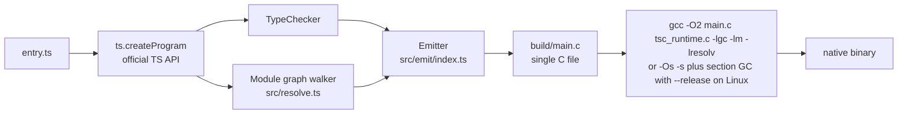
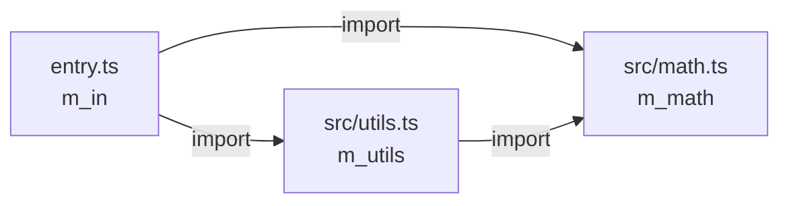
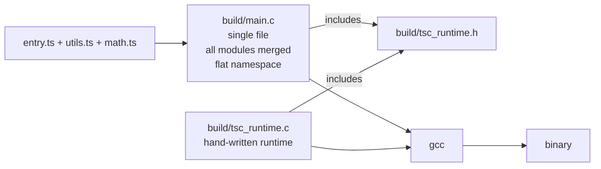
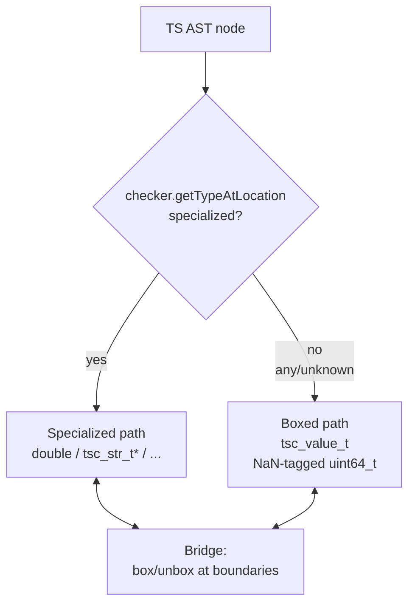
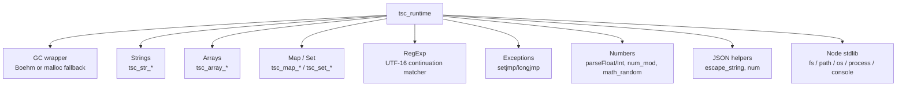
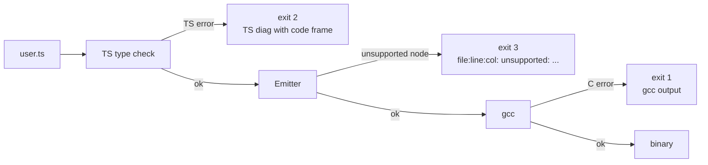

# Architecture

How `tsc2c` turns a TypeScript source tree into a native gcc-linked binary.

The frontend control static-semantics worklist carries one lexical iteration-name set with each control context. Lexical heads contribute their shared BoundNames, and every var binding tree in the body checks that set. Nested function bodies and class static blocks begin independent contexts; nested branches and loops retain the applicable enclosing constraints. Duplicate names and required initializer grammar checks precede reachability and emission. Both compilation and the native Test262 parse phase consume this same decision.

Ordinary named-property and value calls now stage their callee/receiver roots before one shared actual-argument List application. Optional callee checks surround the complete List evaluation; ordinary and spread elements use the same source-ordered traversal. Number toString calls and named/computed method-value reads enter ordinary property lookup, retaining mutable descriptor semantics and actual return values. The primitive intrinsic validates its receiver before shared number-hint ToNumber radix conversion. Native Number formatter calls and the unreachable dynamic toString helper are removed; other typed Number method specializations remain separate work.

## Top-level pipeline



Every step maps to a file under `src/`:

| Stage | File | Responsibility |
|-------|------|---------------|
| Parse + type-check | `src/program.ts` | wraps `ts.createProgram` with our compiler options and `stdlib/lib.core.d.ts` as the ambient lib |
| Module requests | `src/module-request.ts` | derives static Module Requests and finite dynamic target collections, normalizes sorted static import attributes, and proves request equality/deduplication |
| Module graph | `src/resolve.ts` | walks `ts.Program.getSourceFiles()`, resolves canonical static Module Requests and dynamic targets via `ts.resolveModuleName`, and separates startup from lazy edges |
| Emit | `src/emit/index.ts` | AST → C via the `Emitter` class |
| Link | `src/link/cc.ts` | spawns gcc with the right flags |
| Orchestrate | `src/compile.ts` | drives all of the above |
| CLI | `src/cli.ts` | commander-based argv parser |

## Emission: six passes per module

Inside `Emitter.emitModule()`, each source file goes through passes. The multi-pass structure lets cyclic declarations resolve (e.g. a class's method can reference another class declared later in the file, or even in a later module).

```mermaid
flowchart TD
    M[sf.statements] --> A[Pass A: struct fwd-decls<br/>typedef struct Foo_t Foo_t;]
    A --> B[Pass B: struct bodies<br/>struct Foo_t { ... };]
    B --> C[Pass C: function + method prototypes<br/>also lifted-arrow protos]
    C --> D[Pass D: function + method bodies<br/>also lifted-arrow bodies]
    D --> E[Pass E: top-level statements<br/>split into file-scope decls<br/>+ mod_init_mX assignments]
```

Native callable identity is stored in one scanned registry keyed by kind, creation Realm, callback code, constructor hook, captured environment and applicable listener identity/order. Exact equality resolves collisions; one open-addressed probe and load-bounded table-growth worklist serve functions, accessors and listeners. Mutable descriptors, name, length and prototypes remain on the identity payload. Registry operations serialize through the runtime mutex, and registration returns the canonical identity after a concurrent duplicate publication. This replaces all full-list lookup predecessors while retaining their existing global ownership lifetime; collectible callable graphs still require ownership for every callable source and cache lifetime work.

Native function records retain their actual boxed value and decoded root in one callable-owner slot. Creation initializes that identity with the creator's metadata; adapting a boxed value or another native signature retains the original value. Equality, truthiness, nullish selection, typeof and computed property reads project through the same owner. The canonical parameter List carries its rest position independently of surrounding syntax: incoming adapters slice actual arguments there, and outgoing adapters append the internal rest List through one rooted index worklist. An uninitialized native function slot projects to undefined and a call throws TypeError after evaluating its arguments. Legacy native call admission and general default/optional parameter activation remain separate work.

Shared value boxing distinguishes a freshly created function/arrow from a legacy nullable native producer. Closure creation is intrinsically non-nullish and uses its physical callable representation directly; only a producer whose source type can carry Null/Undefined needs the nullable projection. This avoids re-entering TypeScript's late-bound computed-property resolver for a function being assigned to that same property.

String bindings retain ordinary declared/captured/module storage. Native string compound addition stages its writable reference and old value before evaluating the right side, then uses the shared value-add operation before publication. Addition retains its source-tree grouping and conversion boundaries. The separate mutable string-buffer binding representation, its source-shape analyzer and concat-chain flattening are deleted: they could expose partial updates, change conversion hints and refer to undeclared storage. Repeated immutable-string appends currently copy their prefixes; any future amortized optimization must preserve ordinary values and complete operations rather than replacing bindings with mutable buffers.

Ordinary addition lowers one source-tree postorder worklist into flat staged operands/results. Transparent expressions preserve operation boundaries and existing source overrides remain leaves. Each node evaluates both operand subtrees before applying addition; primitive Number/BigInt/String operations share one operand dispatcher with non-suspending generator-resume addition, and other values use ordinary default-hint conversion. Boxed intermediate values and native pointer results retain decoded/volatile roots across later operations. Runtime primitive/numeric conversion records retain both operands and refresh their decoded roots before converting the next value. Try, catch and finally Blocks enter the same lexical declaration collection and scope creation path as other Blocks.

Number formatting uses one exact GMP rational interval between the midpoints of adjacent binary64 values. Endpoint inclusion follows significand parity; the largest finite value uses the specified extra power-of-two neighbor. An exactly normalized radix scale becomes finer until its integer interval is nonempty, then the formatter selects the closest coefficient with an even tie and strips radix factors. This establishes minimal significant digits independently of output length. One dynamically sized positional/scientific layout implements decimal thresholds and every supported radix. Number coercion and JSON share this formatter; the snprintf/strtod search, capped radix buffers and observable machine-integer shortcuts are deleted. Machine-integer text helpers remain for internal indices. Primitive wrapper declarations retain the shared boxed object representation and its [[PrimitiveData]].

Requested decimal precision uses the same coefficient/digit/point record and dynamic layout. Exact quotient/remainder rounding chooses the larger positive coefficient at a halfway value; shortest text chooses even ties. Fixed precision selects its decimal grid directly, significant precision derives it from exact radix normalization, and a carry updates the point before rendering. Specified option domains are checked before machine-integer conversion. One Number prototype descriptor collection installs ordinary Realm-owned formatting methods; shared receiver validation and ToNumber intake preserve each method's non-finite/range ordering. Typed calls and method values use ordinary lookup and rooted actual argument Lists. The capped snprintf formatters, manual decimal rounding helpers and dynamic formatting shortcuts are deleted.

Locale invocation uses one rooted receiver/property/argument-List operation. Object.prototype.toLocaleString returns the actual result of Invoke(receiver, "toString") without coercion or fallback. Array.prototype.toLocaleString boxes its receiver, reads and converts length once, and traverses live indexed values through one worklist; non-nullish elements receive an empty argument List and their results use string-hint conversion. The runtime does not include ECMA-402: Number and BigInt use intrinsic decimal text, the Array separator is comma, and reserved options are ignored. These are documented ECMA-262 implementation choices. Ordinary Realm-owned numeric locale methods validate actual primitive data; BigInt/Symbol prototypes carry no instance data. Symbol accessors and symbol-key intrinsics are installed at prototype creation, independently of constructor lookup. Native primitive and Array locale calls retain ordinary lookup, and the shared ordinary-method set prevents purity analysis from deleting observable calls. Direct locale coercion/join and Object-call shortcuts are removed. Other native Date, typed-array, class and Node-object locale projections remain separate work.

Exact Number prototype text/value clauses bind reciprocal property, generated native stress, declaration and implementation evidence to clause-only Test262 queries. The argument-width generator supplies one iterator-derived actual List; every ignored item is evaluated before option conversion, and the same runtime List path serves each intrinsic. Cardinality follows from that shared worklist rather than fixture counts. Numeric selection is established separately by rational rounding-cell and shortest-interval properties. The Number locale choice has an explicit specification-obligation record backed by its executable fallback property. Legacy section prefixes, semantic directories and source-hashed generic-metadata overrides retain exact owners without substituting names for proof. Broad Numbers/Dates and signed host/report eligibility remain separate unfinished work.

Array ABI conversion retains one canonical owner for identity, properties, holes, prototype, integrity flags and iterator state. A matching codec borrows that owner immediately. Boxed storage can adopt a physical codec through one raw-cell worklist, with primitive kind checks and an exact SameValue round trip before publication; descriptor-owned indices remain in the ordinary property representation. Array literals may select their initial physical codec before any native view escapes. Existing incompatible native views fail closed. The former emitter materializers that copied an Array across a parameter or return boundary are removed; shared general views and ordinary class/function/entry boxing remain to be completed.

Native aggregate field layout follows one ordered field collection. Every boxed field carries a decoded pointer beside its NaN-boxed value; both belong to the same heap or stack owner, so unreachable cycles remain collectible. An ancestor worklist emits inherited value/root pairs with an identical base prefix. Field writers use one runtime store and an offsetof projection from the field address, while static cells carry a file-scope decoded root. Ordinary assignment references stage the owner before the right side and perform GetValue/PutValue at their respective evaluation points. Reads use physical declaration storage independently of flow narrowing, and boxing a native interface installs the shared field adapters. Inherited physical type changes and internal layout collisions fail closed rather than producing incompatible C layouts. Legacy generator field references need a continuation-held owner/key record before they can use this path across suspension.

Pass A and B handle **both** class declarations and interface declarations — interfaces become C structs with fields, no methods. The emission is ordered A..E so every name is declared by the time it's used.

Pass E is the only place where module-scope `const`/`let` are special-cased: they're split into a file-scope declaration (`static T name;`) and an assignment inside `mod_init_mX()`. This promotion is what makes top-level names visible to functions + lifted arrows.

## Module graph + init ordering



Topo-sorted: `[m_math, m_utils, m_in]` (leaves first).

The final `main.c` calls mod_inits in that order, then returns:

```c
int main(int argc, char** argv) {
    tsc_bootstrap(argc, argv);
    mod_init_m_math();    // deps first
    mod_init_m_utils();
    mod_init_m_in();      // entry module last
    return 0;
}
```

Every runtime-reachable module's top-level statements execute inside its `mod_init`. Type-only import/export edges still let declarations from the referenced source file contribute C types and prototypes, but `main()` does not call that module's `mod_init`, so `import type` does not trigger runtime side effects. A narrow CommonJS package-source subset treats top-level `exports.name = ...`, `module.exports.name = ...`, chained `exports.name = module.exports.name = ...`, chained `module.exports.name = exports.name = ...`, `exports.name = void 0` / `module.exports.name = void 0` placeholder elision, `exports.default = ...`, `Object.defineProperty(exports, "default", { value })` default interop, `Object.defineProperty(exports, "name", { value })` / `Object.defineProperty(module.exports, "name", { value })` data exports, top-level `Object.defineProperties(exports, { name: descriptor })` descriptor-map exports, top-level `Object.assign(exports, { name: value })` / `Object.assign(module.exports, { name: value })` data/default export mutation, top-level `Object.assign(exports, require("./local.js"))` / `Object.assign(module.exports, require("./local.js"))` package-local re-export mutation, simple zero-arg `Object.defineProperty(..., { get() { return value; } })` getter exports, string-literal and statically computed `exports["name"] = ...` / `module.exports["name"] = ...`, object-literal identifier/function-valued/arrow-function-valued/method/primitive-literal exports, function-valued / arrow-function-valued / identifier-valued / primitive-literal / array-valued / static object-or-array-literal and supported runtime-computed dynamic-object `module.exports = ...` defaults via `Object.assign`/`Object.create`/`Object.defineProperty`/`Object.defineProperties`/`Object.fromEntries`/`Object.setPrototypeOf`/`Object.preventExtensions`/`Object.seal`/`Object.freeze`, including object-spread defaults over dynamic object values and object-literal named exports that spread package-local `require(...)` results, top-level literal `const pkg = require("pkg")` member reads/calls, top-level literal `require("pkg").name` member reads/calls, top-level literal `require("pkg")` reads for module-exported default values, top-level literal `require("pkg")(...)` calls for function-valued module exports, top-level literal `const { name, alias: local } = require("pkg")` bindings, top-level literal `const fn = require("pkg")` calls for function-valued module exports, package-local top-level literal `require("./local.js")` member/default/direct-default/member-default re-exports including `exports = module.exports = require("./local.js")` chains, top-level and package-local literal `module.require(...)` member reads/calls/re-exports, side-effect-only top-level `require("pkg")`, transpiled-ESM `Object.defineProperty(exports, "__esModule", ...)` and `exports.__esModule = true` marker elision, `__filename` / `__dirname` reads, and read-only `module.filename` / `module.id` / `module.path` / `module.loaded` / `module.paths` / `module.parent` / `module.children` / `module.isPreloading` metadata as exported module bindings/init edges instead of modeling the full CommonJS `exports` object and wrapper.

Before TypeScript parsing, one scanner worklist recognizes the module-specifier transition shared by every static import and re-export form. When ECMA-262-permitted line-terminator trivia precedes an import-attributes `with` clause, an equal-width parser shadow replaces only that trivia with spaces; the resulting `SourceFile` exposes the exact original bytes and retains original node offsets.

Test262 Script roots model supported simple-name `var` bindings through the host's canonical global-object environment. One ancestor walk admits any such declaration whose variable scope reaches the Script source file—including loop heads and arbitrarily nested statements—and stops at function, class, static-block, or module boundaries. Declaration instantiation creates those properties before evaluation; every initializer, identifier access, and global-object access then shares the same binding.

The native module graph validates attested JSON resources with a strict lexical/container frame worklist rather than a host `JSON.parse` call. Valid JSON produces a synthetic Module Record with exactly one `default` binding; malformed source and named-import requests therefore fail during resolution for their specified causes. The compiler includes resolved `.json` records with TypeScript's JSON parse goal, allocates one exporter-owned `tsc_value_t` slot, evaluates the validated source once through the runtime parser, and routes direct default, `default`-alias, and namespace imports to that same identity. The namespace path exposes only the sorted `default` export through the existing non-extensible, null-prototype Module Namespace Exotic Object representation.

Dynamic `import()` separates its two semantic concerns. A source-tree worklist derives the finite canonical set of statically provable target specifiers needed by the native linker, without treating those lazy targets as startup edges or assigning compile-time meaning to the options expression. At runtime the emitted ImportCall evaluates the specifier expression and options expression once in source order, creates the Promise, converts the specifier, reads `options.with`, and collects enumerable own string-keyed attributes through the ordinary object/Proxy path. Abrupt conversion, getter, descriptor, enumeration, and value completions reject with the exact thrown value; non-objects, non-string values, unsupported keys/types, and JavaScript/JSON resource mismatches reject with `TypeError`. The queued import job walks the selected target's static dependency graph in dependency-first order and resolves to its stable namespace object. Every `mod_init` is guarded by one unstarted/evaluating/evaluated/failed state machine, so repeated requests share evaluation and failures. Specifiers without a finite AOT proof still fail closed rather than guessing a host load.

The one-argument runtime `JSON.parse` path mirrors that strict grammar while materializing values through a separate explicit root/array/object frame worklist, so nesting does not consume the C call stack. JSON whitespace and number grammar are ASCII-exact, decimal conversion is isolated to the C numeric locale, malformed input throws `SyntaxError`, escaped lone UTF-16 surrogates survive through the runtime's WTF-8 representation, and object members are created as own data properties so `"__proto__"` does not mutate the result prototype. Compile-time dead-code elimination may discard a statically known parse only after the same strict validator proves that its source cannot throw.

Static finite `require(...)` calls are collected throughout a source file, including function bodies and local `require` / `module.require` aliases, so function-scoped bindings can resolve to package-source exports. The specifier proof accepts literal strings plus top-level const string aliases, concatenation, template expressions whose parts are all statically known, conditional alternatives, identifiers annotated as finite string-literal unions or finite template-literal string types with string, numeric, bigint, boolean, null, or undefined literal placeholders, and top-level const string maps/arrays used through element/property access, including maps whose keys are statically computed. CommonJS package condition resolution recognizes `node-addons`, `node`, `require`, `module-sync`, and `default` branches in package order, including wildcard package `exports`, package-private `imports` target substitution, package-private `imports` external package targets, and array fallback targets. TypeScript package-source import resolution runs the bundler resolver with Node's `node-addons`, `node`, and `module-sync` conditions enabled, so ESM import edges can select package `exports` / package-private `imports` `node-addons`, `node`, or `module-sync` branches, wildcard targets, array fallbacks, and package-private `imports` external package targets. The module graph keeps import/export edges and CommonJS require edges in separate per-module specifier maps, so `import "pkg"` and `require("pkg")` from the same file can select different conditional package branches during AOT graph construction. Non-finite dynamic require sites may instead use `--dynamic-require-manifest <path>` with JSON shape `{ "requires": ["./specifier"] }`, a named object map such as `{ "requires": { "primary": "./specifier" } }`, or caller-scoped entries such as `{ "requires": { "src/loader.ts": ["./specifier"] } }`; caller-scoped keys resolve relative to the manifest file and only apply to exact normalized absolute source-file path matches, so unmatched dynamic callers remain rejected. Each listed specifier is compiled into the AOT module graph for the matching caller. Side-effect-only finite alternatives are all emitted as eager module edges; value-returning finite alternatives currently dispatch AOT-known `module.exports = ...` values or materialized named-export objects by comparing the evaluated specifier at runtime. Dependencies execute eagerly through `mod_init` by design; `tsc2c` does not attempt load-on-demand CommonJS execution for compiled binaries.

For the current package-source subset, untyped JavaScript object and array literals lower to `tsc_value_t` dynamic objects/arrays in local declarations, default-exported object literals, and named/default/namespace imports, which keeps common JS package initialization patterns compatible with dynamic `Object.assign(...)`, `Object.defineProperty(...)`, `Object.defineProperties(...)`, and `Object.fromEntries(...)` paths. Static-entry `Object.fromEntries(...)` class values can resolve back to the existing AOT class layout for construction before crossing the CommonJS `tsc_value_t` boundary and receiving dynamic method/field adapters. Local CommonJS factory invocations that pass a static `require(...)` or `module.require(...)` argument now propagate the scoped dependency alias into the factory body, including bounded top-level local identifier aliases, static-require identifier or object-destructuring variable bindings and resolved require-member expressions before the final object return, inline function/arrow direct calls and `Function.call`, `Function.apply` with a static array, `Reflect.apply`, and `Function.bind` wrapper calls, alongside named local factories; outer CommonJS factory wrappers can also receive those bounded local factory aliases and propagate `require` / `module` / `exports` into assigned named exports or return-valued `module.exports` object results; class-valued object results can likewise resolve through the AOT graph, including a zero-argument factory or top-level local factory alias wrapped by `Object.seal(...)`, the `Object.freeze(...)` object-preserving wrapper, composed `Object.freeze(Object.defineProperties(...))`, use as an `Object.assign(...)` source, or serve as an `Object.defineProperty(...)` / `Object.defineProperties(...)` target; broader factory and object-preserving wrapper forms remain deferred. JavaScript ESM packages can also import and call default function values or construct named class defaults from external CommonJS package dependencies, alongside the documented object-literal dependency path. Named class defaults use the existing AOT class layout and constructor/method lowering while crossing the CommonJS `tsc_value_t` interop boundary. JavaScript package re-export barrels also reuse TypeScript's alias metadata, so named re-exports, default-export aliases, and export-star bindings can resolve back to the source declarations already included in the AOT graph.

Cycles: graph worklists stop at back edges and every module initializer returns from the evaluating state, preventing recursion and duplicate execution. Exact cyclic evaluation ordering and all live-binding/abrupt-completion observations remain open; if module A reads module B before B's binding is initialized, the current native storage can still expose its C zero value.

The current JavaScript package interop subset also carries direct named class exports and named class values from external CommonJS object-literal modules through the AOT class layout and constructor/method lowering, crossing the CommonJS dynamic-value boundary at the import surface. It also follows class-valued ESM named/default re-exports and static `require(...)`-backed CommonJS object properties through that same AOT class graph, including `Object.defineProperty(...)` / `Object.assign(...)` wrappers whose boxed instances expose generated method and field adapters. Broader class-valued wrapper/re-export shapes remain part of the Phase 14 TODO.

## Multi-file output model



Every user-defined module merges into one `main.c`. This keeps the flat symbol namespace viable at link time. A future session can switch to per-module `.c`/`.h` files once symbol prefixing is in, but flat-namespace was enough for the current 24-test suite.

## Value representation (typed path)

The typed emitter prefers specialized C types and uses a NaN-boxed dynamic value for `any` / `unknown` / heterogeneous unions. JavaScript variable declarations use the boxed representation regardless of checker inference: initializer results and mutable writes are runtime values. The shared declaration-storage selector feeds local/global storage, closure cells, namespace reads and continuation fields. A planned capture cell owns initialization's physical type, including on the typed path. Initializer-specific JavaScript function/object/array storage predecessors are deleted. The `CType` model (in `src/emit/types.ts`) otherwise decides the C spelling based on TypeScript's inferred or annotated type:

| TS type | C type | Notes |
|---------|--------|-------|
| `number` | `double` | IEEE 754; int optimization deferred |
| `symbol` | `tsc_symbol_t*` | unique symbol identity plus global registry |
| `string` | `tsc_str_t*` | immutable UTF-8, GC'd |
| `boolean` | `bool` | `<stdbool.h>` |
| `any` / `unknown` | `tsc_value_t` | NaN-boxed dynamic value for numbers, strings, booleans, null/undefined, arrays, and dynamic objects |
| `void` / `null` / `undefined` | `void` / NULL sentinel | for pointer types |
| `T[]` / `Array<T>` | `tsc_array_t*` | dynamic array, element type known at emit |
| `Map<K, V>` | `tsc_map_t*` | type-erased runtime; key kind tag chooses compare fn |
| `Set<T>` | `tsc_set_t*` | same |
| `WeakMap<K, V>` | `tsc_map_t*` | pointer-key map without iteration API |
| `WeakSet<T>` | `tsc_set_t*` | pointer-key set without iteration API |
| `WeakRef<T>` | `tsc_weakref_t*` | typed target pointer wrapper |
| `RegExp` | `tsc_regexp_t*` | ECMAScript AST, continuation graph, and UTF-16 offsets |
| `(args) => ret` | `tsc_fn_*_t*` | typed closure value with generated `{fn, env}` struct; function-scope captures use GC-managed ref cells |
| `class Foo` | `Foo_t*` | struct with inherited fields laid at prefix |
| `interface Foo` | `Foo_t*` | same (struct of fields, no methods) |

When two CTypes disagree (e.g. assigning `null` to a `string` field), `Emitter.coerce()` inserts the bridge. Valid coercions today:

- `void` → any pointer kind = typed `NULL` cast
- any value → `string` = `tsc_str_from_num/bool/lit` helper
- same-kind classes with different names (up-cast) = C cast

Cross-type arithmetic / equality is rejected by the emitter with a `Cannot coerce` diagnostic.

## Dynamic value path

Phase 3 dynamic values use NaN-boxed `tsc_value_t` for `any` / `unknown` and heterogeneous unions, with descriptor-aware dynamic objects and arrays, shared Object/Array prototype values, hidden-class shape metadata, and focused inline caches on hot dynamic property sites. The plan in `~/.claude/plans/make-a-typescript-to-floating-comet.md` still covers broader performance and polish work; summary:



The current bridge boxes specialized primitives/arrays into `tsc_value_t` and supports dynamic JSON/object/array access, dynamic arithmetic/equality/relational/logical/nullish operators, shared Object/Array prototype method dispatch, descriptor-aware Object/Reflect helpers, per-site shape-validated caches for selected object property and Reflect get/set operations, and unboxing into typed destinations. Remaining roadmap work is tracked in [`todo.md`](todo.md#1-next-up-unblockers), starting with `async` / `await` lowering and libuv-backed async I/O.

## Runtime layer

`runtime/tsc_runtime.h` + `runtime/tsc_runtime.c` are the C runtime. Every produced binary includes these. Grouped by feature area:



Symbol-level reference: [`runtime-reference.md`](runtime-reference.md).

## Memory model

- Boehm GC (`libgc-dev`) by default. All user-visible allocations go through `TSC_GC_MALLOC` (tracked) or `TSC_GC_MALLOC_ATOMIC` (raw bytes, no scan).
- Fallback: `--no-gc` compile flag swaps the macros for `calloc`. The binary leaks everything but runs — useful in environments without libgc.
- Exception path: `setjmp`/`longjmp` with a single global error string (`g_current_error`). No stack traces yet.
- Classes and interfaces are pointer-backed; most values are heap-allocated, with narrow escape-analysis paths stack-allocating same-block non-escaping `new Class(...)` locals and typed object literal locals.
- Strings are immutable — every mutation returns a fresh allocation.

## Diagnostics flow



Three distinct exit codes let callers (tests, CI, other tools) tell categories of failure apart.

## Files-to-know list

For readers planning to modify the emitter:

- `src/emit/index.ts` — the whole `Emitter` class. One method per AST node kind.
- `src/emit/types.ts` — CType and `mapTsType` (the single source of truth for TS → C type mapping).
- `src/emit/cbuf.ts` — indent-tracked C source writer, raw preprocessor lines for `#line`, and string escape helpers.
- `src/emit/mangle.ts` — C keyword collision avoidance.
- `src/resolve.ts` — the module graph.
- `src/compile.ts` — the glue; typically read first for orientation.
- `runtime/tsc_runtime.h` — the authoritative list of runtime capabilities.
- `stdlib/lib.core.d.ts` — the authoritative list of what TS the checker will accept.

### Ordinary logical values and nullable storage

Logical &&/||/?? expression trees lower through one postorder worklist. Existing staged source overrides remain leaves; each logical node stores its left operand once and embeds its right operand only in the selected conditional arm. One value-selector primitive is also used by non-suspending generator-resume expressions. Identical non-nullish physical types can remain native, while mixed representations cross the shared boxed value/root boundary. There are no separate String, Array, pointer or Boolean expression algorithms. Pure static short-circuit facts may omit unreachable right subtrees while retaining the left read.

Every nullable union uses canonical boxed storage across declarations, parameters, fields, returns and captured/resumable cells. Legacy native producers that return NULL for one known nullish arm cross the same evaluate-once boxing operation before ordinary consumers observe them; an ambiguous native sentinel fails closed. Generality follows from expression-worklist traversal and the shared union/boxing rule, independent of tree width or depth. Boxed-to-native Array/function identity conversion remains separate work.

### Lexical block declaration instantiation

`src/emit/lexical-declarations.ts` collects the direct variable binding trees and named function/class declarations of a statement list. Ordinary Blocks and flattened CaseBlocks allocate their value/TDZ/root collection through the same scope-entry emitter, then initialize every supported function closure before executing statements. Captures retain fresh heap cells, while uncaptured bindings use rooted locals. Source block boundaries remain C scopes on conditional and loop paths; they are never flattened. The async CFG uses the same collection in scope-enter records and initializes function closures after replacing the complete binding-cell collection. Generality follows from declaration-list traversal and graph re-entry, independent of declaration or execution counts. Function-body instantiation and local Annex B companion bindings remain separate work; unsupported class and async-generator definitions fail closed.

Ordinary `for` declaration heads project that same lexical declaration collection into the scope emitter before evaluating any initializer. Variable statements and loop heads call one declaration-list lowering; physical boxed storage, roots and captured-cell layouts cannot diverge. `let` edges copy captured value/root/TDZ cells before the first condition and between the body and update, while uncaptured locals may reuse storage and `const` keeps one environment. Continue destinations pass through copying even when no increment exists. The async graph projects the same head bindings onto scope-enter and scope-clone records. For-of allocation shares the scope emitter; each binding pattern flows through the existing BoundNames/BindingInitialization trees. Unsupported head disposal records fail through the shared completion diagnostic.


Generator representation probes intern AST-node/role states into a dependency graph. A reverse worklist computes the least fixed point of seed, alternative and conjunction edges; unseeded cycles remain false without recursive classifier calls. JavaScript variable initializers keep the boxed declaration ABI even when immutable. When a native async result is adopted, an existing destination codec remains available until a source supplies its own codec.

### Ordinary synchronous iteration

Ordinary for-of lowering creates one `tsc_sync_iterator_t` through actual `@@iterator` and `next` lookup. Its lexical owner spans the complete loop and uses the same C cleanup contract as runtime exception frames, so native control-flow edges unwind arbitrary nested owners in reverse scope order. Each step precedes the binding/body exception frame: step failures complete the record; binding/body throws call the shared close operation with original-throw precedence. Fresh returned boxed values retain a decoded root while owners close. This is a cardinality-independent lowering over the source control tree, not an iterator snapshot or a control-edge fixture catalog.

The head lexical environment is uninitialized while the RHS executes. Each body iteration allocates a fresh collection of value/TDZ/root slots, sharing identifier and closure operations with CaseBlock environments. The existing BindingName tree initializes those slots, including nested object/array defaults, rest and iterator closing. Object-literal methods and accessors join the existing capture collection. Map/Set use the same ordinary protocol. Remaining native Buffer/URLSearchParams/custom-class adapters and resumable emitters require integration; disposal scopes fail closed through one stable completion diagnostic. Synchronous finalizers share the lexical completion worklist.

Map/Set retain one stable insertion-link collection separately from dense key/value slots. Deleted links carry no payload; live cursors skip them and can reach later append operations even after clear. Dense compaction updates link indices, while permanent completion releases the source. Realm-owned descriptors, constructors and cached instance wrappers expose the ordinary protocol, using shared Array element codecs at typed storage boundaries. One cursor drives factories, next and forEach. Typed storage currently rejects values outside its representable domain; arbitrary typed mutation/class identity and typed constructor intake remain open.

The rooted synchronous iterator record and close operations live in runtime/tsc_iterator.c. GetIteratorDirect shares that record without reading @@iterator. Common Iterator-prototype forEach/reduce use one consumer algorithm with actual callback Lists, a rooted accumulator and an arbitrary-precision index. Callback errors close with original-error precedence; step errors complete the record without closing. Remaining helpers and the Iterator constructor are separate work.

### Ordinary Promise construction and resolution

One actual argument List enters the ordinary Promise constructor. Validation precedes newTarget prototype lookup; one stable object wrapper retains the allocation Realm and one shared AlreadyResolved record gates the resolving-function pair before observable then lookup. A callable then queues a rooted job containing its receiver, method and Realm. Each job creates a fresh pair over the same target, allowing finite repeated thenables without recursive C calls or an identity-based cycle heuristic. Only actual Promise self-resolution rejects with TypeError.

NewPromiseCapability retains the result object and both actual callbacks, including custom constructors. Species-driven reactions and generic catch/finally use those records and ordinary property invocation. Typed consumers cross native pointer payloads through one result codec before the same reaction path; boxed/native conversion preserves identity and schedules no adoption. The former executor, typed reaction and fresh bound-method adapters are deleted. Promise.try forwards the actual argument List after capability construction. One rooted call-completion record catches only the source callback and is also used by reaction jobs; capability callback failures propagate outside that boundary. All/race/any/allSettled share ordinary iterator intake, one result/error List and remaining sentinel, with per-element gates and actual resolve/then calls. allSettled shares each gate between both outcomes; race forwards the capability callbacks directly. Step failures complete the iterator record, while consumer failures close with original-error precedence before rejection. Result snapshots cross the shared Promise and Array element codecs for typed and awaited consumers. Eager combinator loops/materializers and purity shortcuts are deleted. Native dispatch uses the same all consumer. Host rejection reporting, arbitrary typed species result storage and wider resumable integration are separate obligations.
